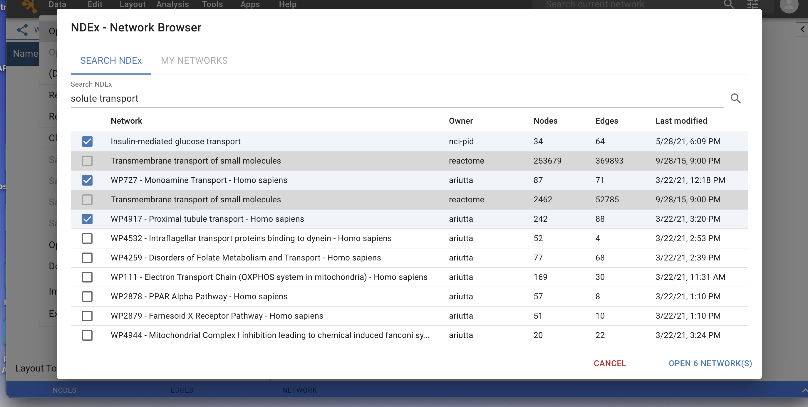
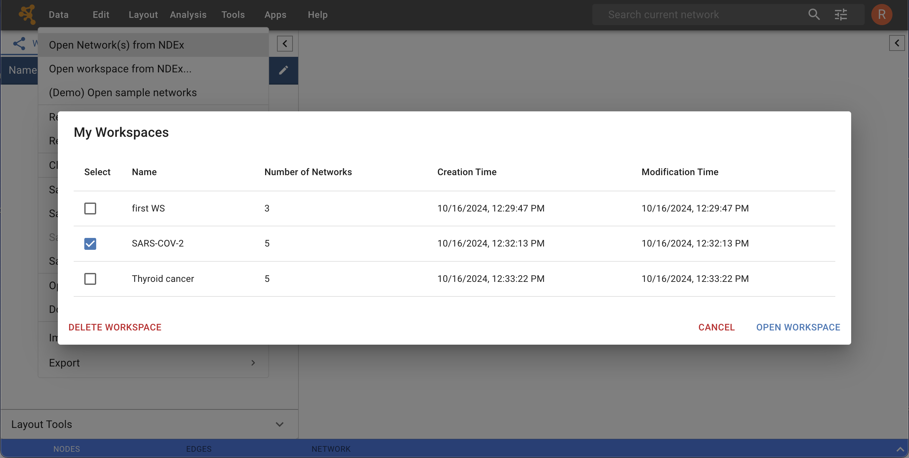
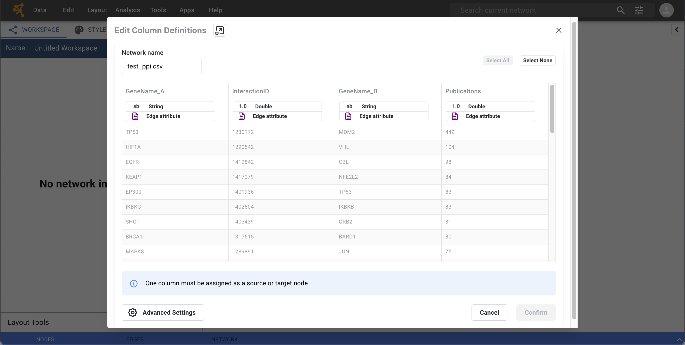
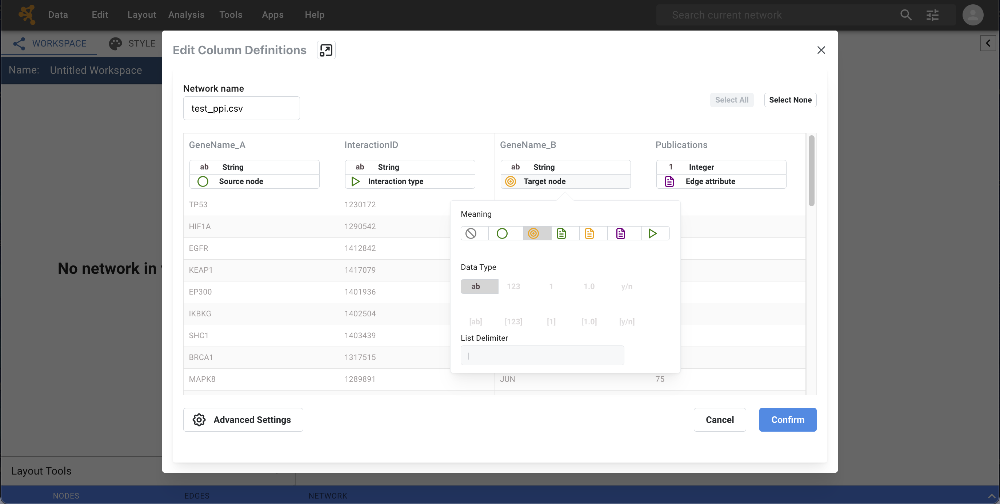

Creating and Saving Networks
====================

There are 3 different ways of bringing networks into Cytoscape Web:

1.  Opening existing networks from the [Network Data Exchange (NDEx)](https://www.ndexbio.org), or opening a workspace saved in NDEx.

2.  Importing network files: CX2 and SIF files, or unformatted tabular text files.

3.  Creating nodes and edges by hand, with **Edit → Create Node** and **Edit → Create Edge** (see [Edit](Quick_Tour_of_Cytoscape.md#edit)).

When the workspace is empty, the center of the window also offers buttons to **Open Sample Networks**, **Import from file**, **Load from NDEx**, or take the guided tour.

## Open Network from NDEx

The NDEx Project provides an open-source framework 
where scientists and organizations can share, store, manipulate, and publish 
biological network knowledge.

To open a network from NDEx, choose **Data → Open Network(s) from NDEx...** in the top menu bar. You can also type search terms in the **Search NDEx** bar at the top of the **Workspace** tab and press **Enter**; this opens the same window with your search already run.

-   The **NDEx - Network Browser** window opens with a list of the latest networks in NDEx.

-   To find networks of interest, type one or more search terms in the **Search NDEx** field (such as BRCA1, Apoptosis etc.) and press **Enter** or click the  button. Search results are returned in order of relevance.

-   If you are [signed in](Quick_Tour_of_Cytoscape.md#login) to your NDEx account, the list includes public networks, your own private networks and networks shared with you; the **Visibility** column tells them apart. Check **Only mine** to see only the networks you own.

-   Folders, and shortcuts to folders, are listed first, in a **Folders** section. Click a folder to open it; the path at the top of the window shows where you are, and you can click any part of it to go back. Shortcuts to networks are listed with the networks and open the network they point to.

-   For each network, the list shows its name, owner, visibility, number of nodes and edges, and when it was last modified. If there are more results than fit in the list, click **Load more** at the bottom.

-   Click a network to select it (or clear its checkbox to deselect it). You can select several networks.

-   Some networks are grayed out and can't be opened, for example because they are already in your workspace, because they are too large, or because they are network collections, which Cytoscape Web doesn't support. Mouse over a grayed-out network for the reason.

-   Click the **Open N Networks** button in the bottom right corner to open all selected networks. The first one becomes the current network.

A network opened from a folder shows the folder's path, as **Imported from:**, in the [Workspace Panel](Quick_Tour_of_Cytoscape.md#workspace_tab).

Networks that are too large to work with in a web browser can't be opened. A network can be opened if it has no more than 20,000 edges, or if it has fewer than 26,000 nodes and edges in total and is smaller than 500 MB.

### Open Sample Networks

Use **Data → Open Sample Networks** to conveniently get started with 4 publicly available example networks stored in NDEx.

## Open Workspace from NDEx

In Cytoscape Web, the workspace is comparable to the [session](https://manual.cytoscape.org/en/stable/Export_Your_Data.html#as-a-session-file) concept in the Cytoscape desktop application.
Therefore, a Cytoscape Web workspace can be saved to, and opened from, a user's NDEx account.
This feature is only available to Cytoscape Web users when they are signed in to their NDEx accounts.

To open a workspace from NDEx, choose **Data → Open Workspace from NDEx...** in the top menu bar:

-   The **My Workspaces** window will open and display all the available workspaces stored in your NDEx account, with the number of networks in each one and when it was created and last modified.

  
-   On the left hand side, select the workspace you want to open.

-   Click the **Open Workspace** button in the bottom right corner. Cytoscape Web asks you to confirm, because the workspace **replaces all the networks** in your current workspace, together with your installed Apps and Service Apps. Click **Load (cannot be undone)** to continue. Cytoscape Web then reloads with the opened workspace.

-   You can also delete the selected workspace from NDEx with **Delete Workspace**.

## Import Network from File

Cytoscape Web can import network files in **[CX2 JSON format](https://cytoscape.org/cx/cx2/specification/cytoscape-exchange-format-specification-(version-2)/)** (.cx2), which is also the format used to store networks in NDEx, and in **[SIF format](https://manual.cytoscape.org/en/stable/Supported_Network_File_Formats.html#sif-format)** (.sif). It can also import networks from delimited text files (.csv, .txt, .tsv), also commonly referred to as network table files. Microsoft Excel files are not supported; save them as .csv or .txt files first. Files must be smaller than 5 MB.

*HINT:*
-   *CX2 JSON files can be generated by the **Cytoscape desktop application** for any networks using **File → Export → Network to File...**. For more details, please review the section [Network](https://manual.cytoscape.org/en/stable/Export_Your_Data.html#network) in the chapter *Export Your Data* of the Cytoscape Desktop manual.*
-   *CX2 JSON files can be generated by the **[NDEx2 Python Client](https://ndex2.readthedocs.io/en/latest/index.html)***
-   *CX2 JSON files can be generated and **[downloaded](Creating_Networks.md#download_cx2_file)** by Cytoscape Web for any network.*

To import a network from a file, choose **Data → Import → Network from File...** in the top menu bar. In the **Upload network file** window, drag your file into the window or click **Browse** to choose it.

-   CX2 and SIF files are opened right away as a new network. If a CX2 file uses style settings that Cytoscape Web can't display, a message tells you which ones.

-   Delimited text files open the **Edit Column Definitions** window, described below.

### Import a Network from a Table File

The **Edit Column Definitions** window lets you specify how the file will be parsed, and shows a preview of the result. As you change the settings, the preview updates automatically. In addition to specifying how the
file will be parsed, you must also choose the columns that
represent the source and target nodes as well as an optional edge
interaction type. This works the same way as [importing networks from table files](https://manual.cytoscape.org/en/stable/Creating_Networks.html#import-networks-from-unformatted-table-files) in Cytoscape Desktop.

The following is a sample network table file:

<table cellspacing="0"  style="table-layout: fixed; dwidth: 700px">
<caption>Sample Network in Table</caption>
<tr> <th class="">source</th>     <th class="">target</th>     <th class="center">interaction</th>  <th class="center">boolean data</th>  <th class="center">string data</th>   <th class="center">floating point data</th> </tr>
<tr> <td class="">YJR022W</td>    <td class="">YNR053C</td>    <td class="center">pp</td>           <td class="center">TRUE </td>         <td class="center">abcd12371</td>     <td class="center">1.2344543</td>           </tr>
<tr> <td class="alt">YER116C</td> <td class="alt">YDL013W</td> <td class="alt center">pp</td>       <td class="alt center">TRUE </td>     <td class="alt center">abcd12372</td> <td class="alt center">1.2344543</td>       </tr>
<tr> <td class="">YNL307C</td>    <td class="">YAL038W</td>    <td class="center">pp</td>           <td class="center">FALSE</td>         <td class="center">abcd12373</td>     <td class="center">1.2344543</td>           </tr>
<tr> <td class="alt">YNL216W</td> <td class="alt">YCR012W</td> <td class="alt center">pd</td>       <td class="alt center">TRUE </td>     <td class="alt center">abcd12374</td> <td class="alt center">1.2344543</td>       </tr>
<tr> <td class="">YNL216W</td>    <td class="">YGR254W</td>    <td class="center">pd</td>           <td class="center">TRUE </td>         <td class="center">abcd12375</td>     <td class="center">1.2344543</td>           </tr>
</table>
 

The network table file should contain at least two columns for creating
network with edges. If the file has only one column, the created network
will not contain any edges. The interaction type is optional in this
format. Therefore, a minimal network table looks like the following:

<table cellspacing="0">
<caption style="width: 240px">Minimal Network Table</caption>
<tr> <th class="">source</th>     <th class="">target</th>     </tr>
<tr> <td class="">YJR022W</td>    <td class="">YNR053C</td>    </tr>
<tr> <td class="alt">YER116C</td> <td class="alt">YDL013W</td> </tr>
<tr> <td class="">YNL307C</td>    <td class="">YAL038W</td>    </tr>
<tr> <td class="alt">YNL216W</td> <td class="alt">YCR012W</td> </tr>
<tr> <td class="">YNL216W</td>    <td class="">YGR254W</td>    </tr>
</table>
 

One row in a network table file represents an edge and its edge data
columns. This means that a network file is considered a combination of
network data and edge attribute data columns. A table may contain columns that
aren't meant to be edge attribute data. In this case, you can choose not to import
those columns.

### Basic Operations

To import a network from a delimited text table, please follow these steps:

1.  Select **Data → Import → Network from File...** 

2.  Drag a file into the **Upload network file** window, or click **Browse** to choose it.

3.  In the **Edit Column Definitions** window, check the **Network name**, which is based on the file name, and change it if you like.

4.  Define the interaction parameters by specifying which columns of
    data contain the source nodes, target nodes and interaction types. Click on a column header in the preview to
    open the column editor, and choose the column's **Meaning**:
    -   **Source node**
    -   **Target node**
    -   **Interaction type**
    -   **Source node attribute** or **Target node attribute**: data about the source or target node, imported into the node table
    -   **Edge attribute**: data about the edge, imported into the edge table
    -   **Not imported**: the column is skipped

    

5.  (Optional)
    -   Define node and edge attribute columns, if applicable. Network table files can have node and edge
        attribute columns in addition to network data. In the screenshot above, the "Pubmed" 
        data column has been defined as an *Edge attribute* and its data type set to *Integer*. 

    -   Choose which columns to import. Set a column's **Meaning** to **Not imported** to skip it, or use **Select All** and **Select None** to import all columns or none.

    -   Change Data Types: Cytoscape Web has a basic data type detection function that automatically
        suggests the column data type according to its entries. This can be overridden by selecting
        the appropriate **Data Type** in the column editor. For lists, a **List Delimiter** must also be specified
        (i.e., all cells in the column must use the same delimiter). The following column data types are supported:
        -   String
        -   Integer
        -   Long integer
        -   Double (floating point numbers)
        -   Boolean (True/False)
        -   List of strings, integers, long integers, floating point numbers or booleans

6.  Click the **Confirm** button in the bottom right corner to complete the process. **Confirm** is available once at least one column is a **Source node** or **Target node** and all values can be read as the chosen data types.

### Import a List of Nodes Without Edges

The table import feature supports lists of nodes without edges. If you
select only a source column, it creates a network without interactions.

### Advanced Settings

The **Advanced Settings** button allows you to:

-   **File Delimiter**: choose the character that separates columns in the file: **Auto-detect** (the default), **Comma**, **Semicolon**, **Pipe**, **Tab**, **Space**, or a **Custom** character.

-   **Decimal Delimiter**: choose whether numbers in the file use a **Dot** (1.23) or a **Comma** (1,23) as decimal separator, or a **Custom** character.

-   **Use first row as column names**: when this option is on (the default), the first row of the file is used to name the columns.

-   **Skip first N lines**: set how many rows at the top of the file to skip. For example, if you want to skip the first 3 rows in the file, set 3 for this option.

## Save to NDEx

Cytoscape Web also allows users to save their networks and workspaces if they are **[signed in](Quick_Tour_of_Cytoscape.md#login)** to their NDEx account. To save a network or workspace to NDEx, choose one of the options available in the **Data** top menu bar item:

   - **Save Network to NDEx** - saves your current network to NDEx.
     - For a network opened from NDEx, this option saves your changes by *overwriting* the existing network in NDEx. In order to use this option, you must either be the network's owner or have *edit* permission on it, and the network must have unsaved changes. Mouse over the menu item to see why it isn't available.
     - For a local network (one you imported from a file or created in Cytoscape Web), this option saves it to your NDEx account as a new network, which then replaces the local network in your workspace.
     - If the network in NDEx was changed after you opened it, the **Networks out of sync** window asks whether to overwrite the network in NDEx or to save a copy instead.

   - **Save Copy to NDEx** - saves a new copy of the current network, named *Copy of* followed by the network's name, to your NDEx account, and opens it in your workspace. The existing source network will not be modified.

   - **Save Workspace** - saves your current workspace to NDEx, overwriting the copy in NDEx. This includes not only your networks, but also any installed Apps and registered Service Apps. The very first time you use this option, you'll be asked to choose a *unique name* for your workspace.
    
   - **Save Workspace As...** - saves a new copy of the workspace to your NDEx account. When using this option, you must always specify a *unique name* for the new workspace to be saved. If a workspace with that name already exists, you are asked whether to overwrite it.

You can also save a network from its **⋮** (**Network actions**) menu in the [Workspace Panel](Quick_Tour_of_Cytoscape.md#workspace_tab). An orange dot on the **⋮** button means the network has unsaved changes.

## Download Network File

Another way to save a network is to download it as a **[CX2 JSON](https://cytoscape.org/cx/cx2/specification/cytoscape-exchange-format-specification-(version-2)/)** file by using **Data → Download Network File (.cx2)**. The file is named after the network.

CX2 JSON files can be opened in the Cytoscape desktop application, uploaded and stored in NDEx, and accessed programmatically via the **[NDEx2 Python Client](https://ndex2.readthedocs.io/en/latest/index.html)**.

The file includes all of the network's [named styles](Styles.md#named_styles). Cytoscape Desktop and NDEx show only the style that was active when you saved the file. If your nodes show images, a message warns you that the images may appear as "?" in Cytoscape Desktop (see [Charts and Images](Styles.md#charts_and_images)).

## Duplicate a Network

To make a copy of the current network, choose **Data → Duplicate Network**, or **Duplicate Network** in the network's **⋮** menu in the Workspace Panel. The copy is named *Copy of* followed by the network's name, includes all of the network's styles, and is stored locally in your workspace. You don't need to be signed in to NDEx; save the copy to NDEx if you want to keep it there.

## Open Network in Cytoscape Desktop

You can send a copy of the current network to the Cytoscape desktop application on your computer with **Data → Open Network in Cytoscape Desktop**, with the  button in the [Network View Panel](Quick_Tour_of_Cytoscape.md#network_view), or from the network's **⋮** menu in the Workspace Panel.

This requires [Cytoscape Desktop 3.10.5 or later](https://cytoscape.org/download.html), running on your computer with the **CyNDEx-2** app installed (see [Software Requirements](Introduction.md#requirements)). Cytoscape Web connects to Cytoscape Desktop on your computer (port 1234), and the option is available only while Cytoscape Desktop is running. It is not available in Safari.

The first time you use this option, the **Connect to Cytoscape Desktop** window explains that your web browser may ask for permission to access your local network. Click **Continue**, and allow access if your browser asks.

The network opens in Cytoscape Desktop as a new network, named *Copy of* followed by the network's name. If your nodes show images, a message warns you that the images may appear as "?" in Cytoscape Desktop.

## Remove Networks

To remove networks from your workspace, choose **Data → Remove Current Network** or **Data → Remove All Networks**, or **Remove the Network from Workspace** in a network's **⋮** menu in the Workspace Panel. Cytoscape Web asks you to confirm. Removing a network from your workspace doesn't delete it from NDEx.
