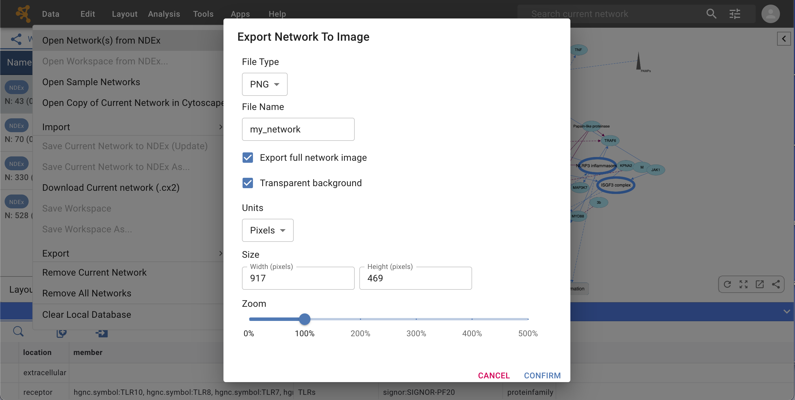

Exporting Your Data
====================

Cytoscape Web lets you export networks as data files and as images:

-   To save a network as a **[CX2](https://cytoscape.org/cx/cx2/specification/cytoscape-exchange-format-specification-(version-2)/)** file, which you can open in Cytoscape Desktop or upload to NDEx, use **Data → Download Network File (.cx2)**. See [Download Network File](Creating_Networks.md#download_cx2_file).
-   To save networks and workspaces to your NDEx account, see [Save to NDEx](Creating_Networks.md#save_to_NDEx).
-   To export a network as an image, see below.

## Exporting Networks as Static Images
Cytoscape Web can generate publication-quality images from network views.

To export a network as image, select **Data → Export → Network to Image...**, or **Export Network to Image** in the network's **⋮** menu in the [Workspace Panel](Quick_Tour_of_Cytoscape.md#workspace_tab).
The **Export Network To Image** dialog will open and look like the image below:

-    You can choose to export the current network view into the following formats: **PNG**, **SVG** or **PDF**, under **File Type**.

-    Enter the **File Name**; it is set to the network's name by default.

-    The image export dialog has a variable number of options based on the file format selected. **Export full network image** is always available:
     -   **PNG**: **Transparent background** (on by default); the image **Size**, as **Width** and **Height** in **Pixels** or **Inches** (with a resolution in **DPI** of 72, 100, 150, 300 or 600 when using inches); and a **Zoom** slider (0% to 500%) to scale the image.
     -   **PDF**: the **Paper Size** (Letter, Legal, Tabloid, A0 to A5, or a **Custom** size), the **Orientation** (portrait or landscape) and the **Margin**.
     -   **SVG**: no other options.

-    Once you have selected the appropriate options, click **Confirm** in the bottom right corner of the dialog window.

-   Finally, choose the destination folder and save your network's image file.

The option to **Export full network image** is checked by default; if you uncheck this option, the exported image will only contain what is displayed in the Network View Panel. So, if you zoom in to display a portion of your network, the exported image will only contain that portion.

***NOTE: We recommend using PDF or SVG for publications because they are standard vector graphics formats, and they are easy to edit in other applications such as Adobe Illustrator.*** For more tips, see [Exporting for Publication](https://manual.cytoscape.org/en/stable/Export_Your_Data.html#exporting-for-publication) in the Cytoscape Desktop manual.

Images shown on nodes are loaded from their web addresses when you export. If the server that hosts an image doesn't allow this, the image may be left out of the exported PNG.
