Filters
====================

The **Filter Panel** (FILTER tab in Control Panel) finds the nodes and edges of a network that meet a set of
conditions, and either **selects** them or **shows** only them. For example, you can find the nodes with
5 or more edges, the edges whose *weight* is between 0 and 5.5, or the nodes with at least two neighbors
whose name contains *gal*.

Filters work like those of the **Filter** tab in the Cytoscape desktop application, and the two applications
can exchange them: a filter file exported from one can be imported into the other
(see **[Sharing Filters with Cytoscape Desktop](Filters.md#sharing_filters)**).

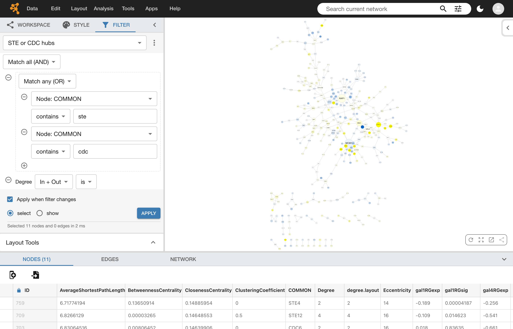

*The **STE or CDC hubs** filter applied to the galFiltered network in select mode: the 11 nodes that pass
are selected (highlighted in yellow), and the **Table Panel** lists them.*

To find nodes and edges quickly by a word or a value, the **[Search Tool](Quick_Tour_of_Cytoscape.md#search_tool)**
in the Menu Bar may be all you need. Filters are for more precise questions, combining several conditions.

## The Filter Panel

The **Filter Panel** has three parts:

-   At the top, the **filter list** shows the filter you are working on. The
    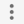 button next to it opens the options menu, to create, rename,
    copy, remove, export and import filters.

-   In the middle are the **conditions** of the filter, which you add with the
     button.

-   At the bottom are the controls to **apply** the filter, and a line that reports the result of the
    last run.

Filters belong to the workspace, not to a network: every filter can be applied to any network of the
workspace. A filter is always applied to the **current network**. When a hierarchy is open and you click in
the **[Sub Network Viewer](Quick_Tour_of_Cytoscape.md#cell_view)**, it is applied to the subnetwork shown
there.

## Managing Filters

There is always at least one filter: the first time you open the **FILTER** tab, an empty filter named
*Default filter* is created. Use the options menu to manage your filters:

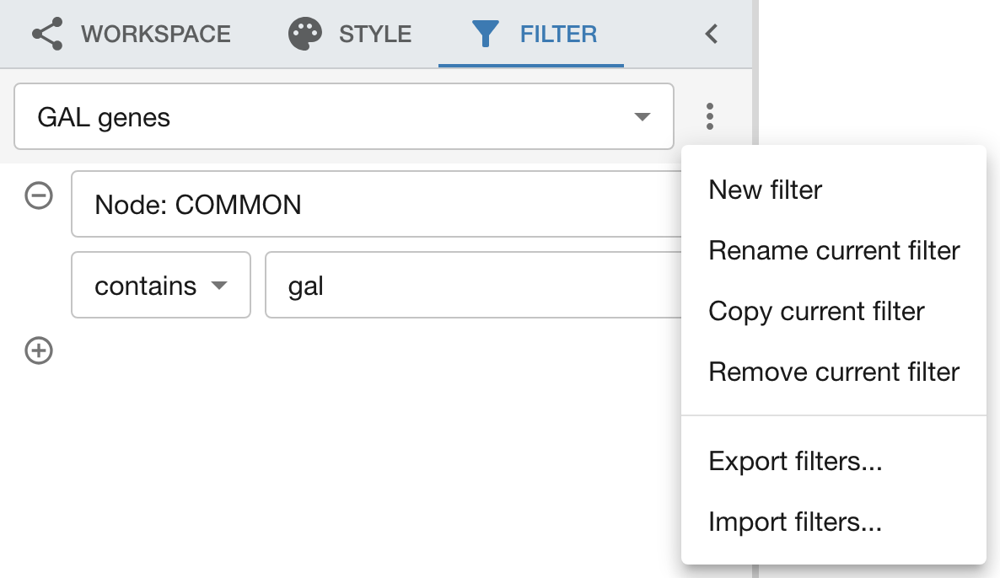

<table cellspacing="0">
<tbody>
<tr> <th class="">Option</th> <th class="">Action</th> </tr>
<tr> <td class=""><b>New filter</b></td> <td class="">Creates an empty filter. You are asked for its name; <i>My filter</i> is suggested.</td> </tr>
<tr> <td class="alt"><b>Rename current filter</b></td> <td class="alt">Changes the name of the filter. Names must be unique; uppercase and lowercase letters are not told apart.</td> </tr>
<tr> <td class=""><b>Copy current filter</b></td> <td class="">Creates a copy of the filter, with a numbered name (<i>Hubs 2</i>).</td> </tr>
<tr> <td class="alt"><b>Remove current filter</b></td> <td class="alt">Deletes the filter, after asking you to confirm. Not available when it is the only filter.</td> </tr>
<tr> <td class=""><b>Export filters...</b></td> <td class="">Saves all your filters to a file named <i>cytoscape-filters.json</i>, which the Cytoscape desktop application can import.</td> </tr>
<tr> <td class="alt"><b>Import filters...</b></td> <td class="alt">Adds the filters of a filter file to your filters. Existing filters are never replaced: an imported filter whose name is already used gets a numbered name. A message reports how many filters were imported, and how many entries of the file were skipped because Cytoscape Web cannot use them.</td> </tr>
</tbody>
</table>

Your filters are kept in your web browser, together with your workspace, and changes are saved
automatically. They are **not** saved to NDEx with your networks or workspaces: use **Export filters...**
to keep a copy of them or to share them.

## Building a Filter

A filter is a list of conditions. Click the  button below the
conditions to add one:

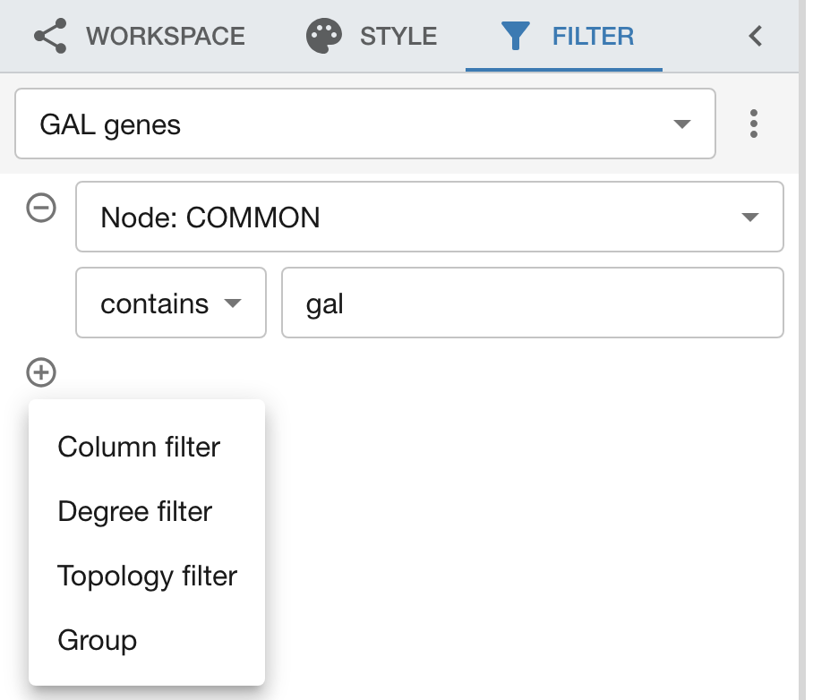

-   **[Column filter](Filters.md#column_filter)**: compares the value of a node or edge column.
-   **[Degree filter](Filters.md#degree_filter)**: compares the number of edges of a node.
-   **[Topology filter](Filters.md#topology_filter)**: counts the neighbors of a node that meet their own
    conditions.
-   **[Group](Filters.md#groups)**: holds conditions of its own, to combine them differently.

Click the  button next to a condition to remove it; removing a
group removes all the conditions in it.

Once a filter has two or more conditions, the **Match all (AND)** / **Match any (OR)** list above them
decides whether a node or edge must meet all of the conditions, or at least one of them.

If a condition cannot work on the current network, for example because its column does not exist there, a
warning icon appears next to it. Point at the icon (or move the keyboard focus to it) to read the reason.
Such a condition matches nothing on this network.

### Column Filter

A column filter compares the values of one column. Pick the column from the list: node columns come
first (*Node: COMMON*), then edge columns (*Edge: interaction*). The comparison offered depends on the type
of the column.

**Numeric columns**

The slider covers the smallest and the largest value of the column; drag its two handles to choose a range.
You can also type the values in the two fields, including values outside the slider.

-   **is**: matches values inside the range, inclusive.
-   **is not**: matches values outside the range. Nodes and edges without a value also match.

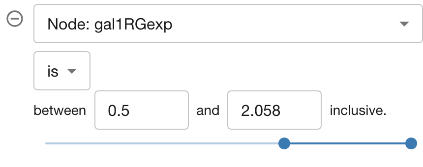

**Text (string) columns**

Type the text to look for, and choose how to compare it:

-   **contains**: matches values that contain the text.
-   **doesn't contain**: matches values that do not contain the text.
-   **is**: matches values equal to the text.
-   **is not**: matches values that differ from the text.
-   **matches regex**: matches values that follow a *regular expression*, which allows much more precise
    matching. The expression must match the whole value: `ste\d+` matches *STE2* and *STE11*, but not *MSTE2*
    or *STE*. Regular expressions use the
    <a href="https://developer.mozilla.org/en-US/docs/Web/JavaScript/Guide/Regular_expressions" target="_blank">JavaScript syntax</a>.

Text comparisons ignore uppercase and lowercase: *gal* matches *GAL4*. Nodes and edges without a value match
**doesn't contain** and **is not**, and none of the other comparisons.

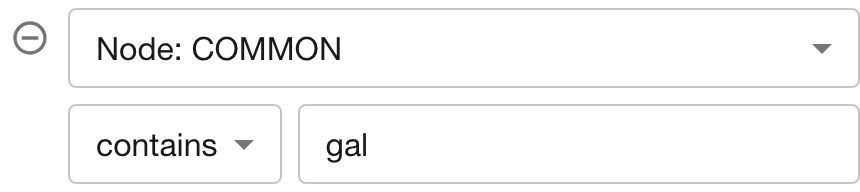

**True/false (boolean) columns**

Choose whether to match the values that are **true** or those that are **false**. Nodes and edges without a
value match neither.

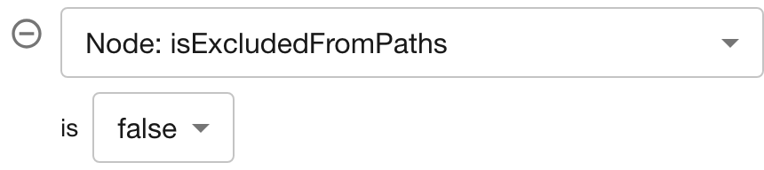

**List columns**

A column that holds a list of values (of numbers, text or true/false) is compared element by element, with one
more choice:

-   **any element**: the node or edge matches if at least one element of its list matches.
-   **every element**: it matches only if all the elements of its list match.

For lists of true/false values, a node or edge matches if any element has the chosen value.

### Degree Filter

A degree filter matches the nodes whose number of edges is inside a range (**is**) or outside it
(**is not**), inclusive. Choose which edges to count:

-   **In + Out**: all the edges of the node.
-   **In**: the edges that point to the node (the node is their target).
-   **Out**: the edges that leave the node (the node is their source).

The slider covers the smallest and the largest degree in the network. Until you change the range, the filter
matches every node.

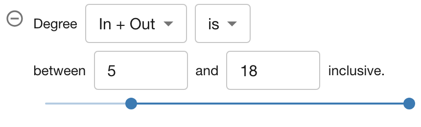

### Topology Filter

A topology filter matches nodes by their surroundings: the nodes that have **at least** (or **less than**) a
given number of neighbors within a given distance, counting only the neighbors that meet the conditions
listed under *where the neighbours match*. Add those conditions with the
 button inside the topology filter, the same way as in the filter
itself.

-   The **distance** is the number of edges to go through: 1 counts the direct neighbors only, 2 also counts
    their neighbors, and so on. The direction of the edges does not matter.
-   A node is never counted as its own neighbor, and the nodes on the way do not need to meet the
    conditions.
-   Without any condition, every neighbor counts.

For example, the filter below matches the nodes that are directly connected to at least two nodes whose
**COMMON** name contains *gal*:

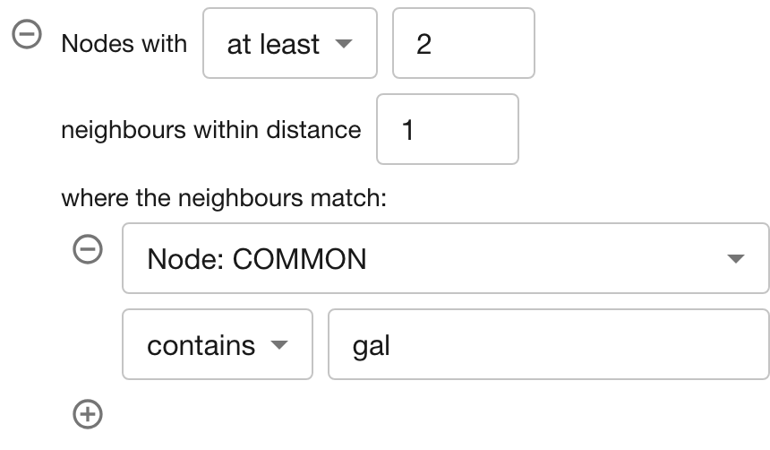

### Groups

By default, a node or edge must meet all the conditions of a filter. To mix **all** and **any**, put some
conditions in a **Group**: a group holds conditions of its own, with its own **Match all** / **Match any**
list and  button, and it counts as one condition of the filter around
it. Groups are drawn with a dashed border, and they can be nested.

For example, to find the nodes whose **COMMON** name contains *ste* **or** *cdc*, but only those with 2 or
more edges:

1.  Add a **Group**, and set it to **Match any (OR)**.
2.  In the group, add a **Column filter** for *Node: COMMON* **contains** *ste*, and another one for
    *Node: COMMON* **contains** *cdc*.
3.  Below the group, add a **Degree filter** with a range starting at 2.

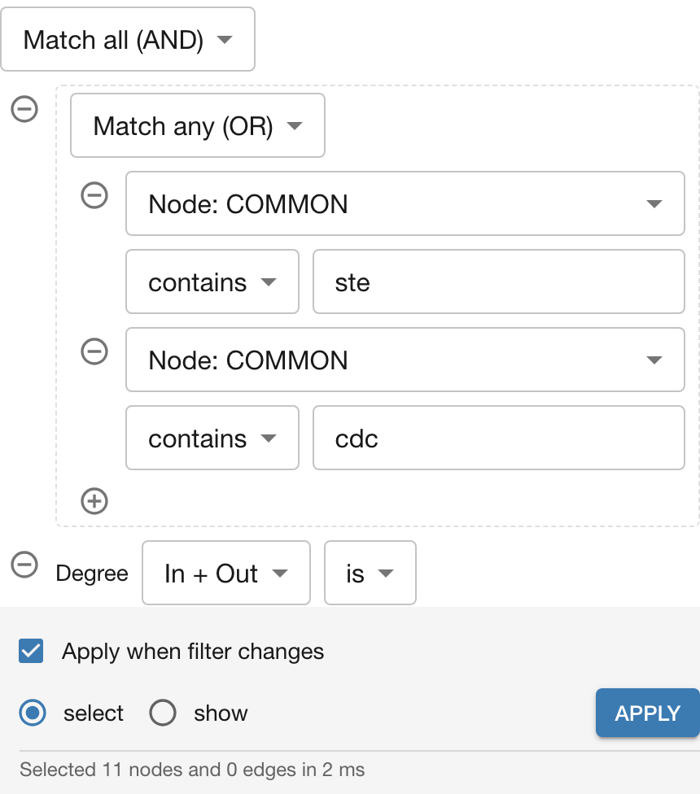

## Applying Filters

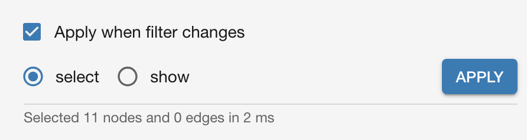

Choose what applying the filter does:

-   **select** (the default): the nodes and edges that pass the filter become the selection, replacing the
    previous one. A filter that only has node conditions selects nodes only: it selects no edges.

-   **show**: the nodes and edges that do not pass the filter are hidden, and the others are shown.
    A filter that only has node conditions hides no edge, but an edge whose node is hidden is not drawn.
    The selection does not change.

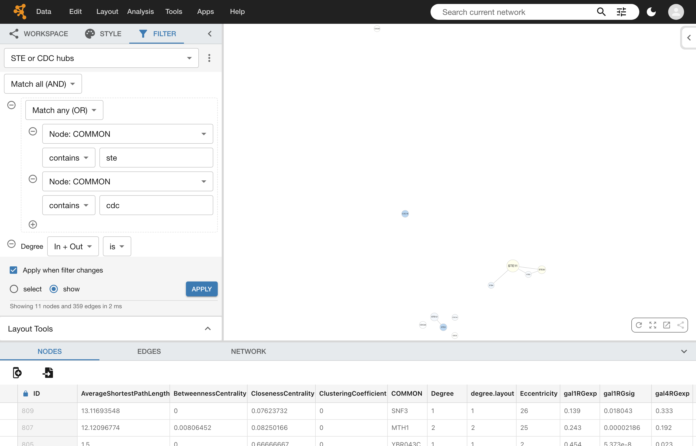

*The same filter in show mode: only the 11 nodes that pass are shown.*

Click **APPLY** to apply the filter to the current network. When **Apply when filter changes** is
checked, the filter is applied again by itself whenever you change its conditions or pick another filter.
This is the default for networks with fewer than 100,000 nodes and edges; for larger networks, check the box
yourself if you want it. Switching between **select** and **show** always applies the filter right away.
Opening the **FILTER** tab or switching to another network applies nothing.

The line under the controls reports the result of the last run, for example
*Selected 11 nodes and 0 edges in 2 ms*.

Some things to know about **show**:

-   Show hides elements by setting the **Visibility** *bypass* of the network's current style (see
    **[Styles](Styles.md#styles)**). The hidden elements are therefore saved with the network: a network
    saved to NDEx or exported while a filter shows only part of it keeps the other elements hidden.
-   Switching a filter back to **select**, or applying any filter in **select** mode after it, shows all the
    nodes and edges again.
-   Applying a filter in **show** mode also shows the elements that you hid before by other means, when they
    pass the filter.
-   Applying a filter cannot be undone with **Edit → Undo**: switch to **select** to show everything again,
    or apply another filter.

## Sharing Filters with Cytoscape Desktop

Filter files are the same in both applications. In the Cytoscape desktop application, use **Export filters...**
and **Import filters...** in the options menu of the **Filter** tab; in Cytoscape Web, use the same options
of the **[Filter Panel](Filters.md#managing_filters)**.

A few differences remain:

-   Cytoscape Web skips the entries of a filter file it cannot use, such as conditions added by Cytoscape
    apps, and imports the others. The import message tells you how many entries were skipped.
-   **Regular expressions** follow the JavaScript syntax in Cytoscape Web and the Java syntax in the desktop
    application. Most expressions work the same way in both; one that uses Java-only syntax, such as `a++` or
    `\p{Alpha}`, shows a warning icon in Cytoscape Web and matches nothing. Case-sensitive matching (`(?-i)` in
    the desktop application) is not available in Cytoscape Web.
-   Filter files created by commands or scripts may compare numbers in ways the **Filter Panel** does not
    offer, such as **is greater than** or **is at most**. Cytoscape Web shows and applies them as they are; if
    you change such a condition to **is** or **is not**, it becomes the closest range (*is at least 5* becomes
    *between 5 and the largest value*).
-   A column condition from a file can apply to the nodes and the edges at the same time; it is shown as
    *Node + Edge: name*.
-   Whether a filter selects or shows is not saved in filter files: imported filters start in **select** mode.

## Filters and Hierarchies

The subnetworks shown in the **[Sub Network Viewer](Quick_Tour_of_Cytoscape.md#cell_view)** of a hierarchy can
have a filter of their own, shown below the network, which lets you choose the sources of data to display.
That filter is separate from the filters of the **Filter Panel**:

-   Applying a filter of the **Filter Panel** to such a subnetwork turns the subnetwork's own filter off.
-   Turning the subnetwork's own filter back on shows again anything a **Filter Panel** filter hid in
    **show** mode, and applies the subnetwork's filter instead. Your filters in the **Filter Panel** do not
    change.

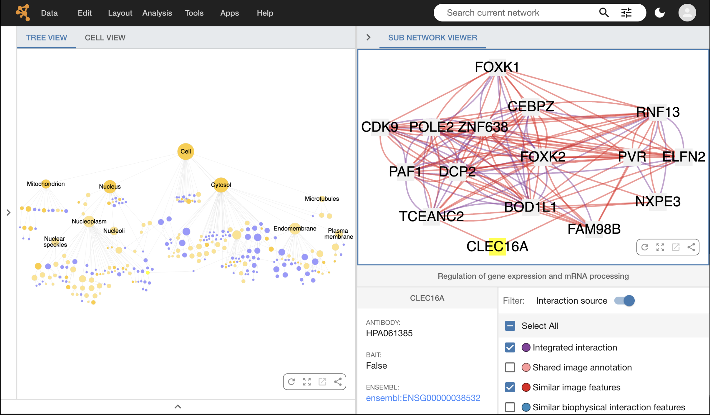
