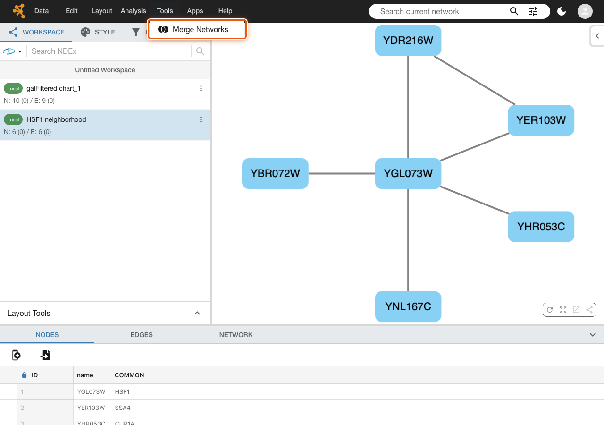
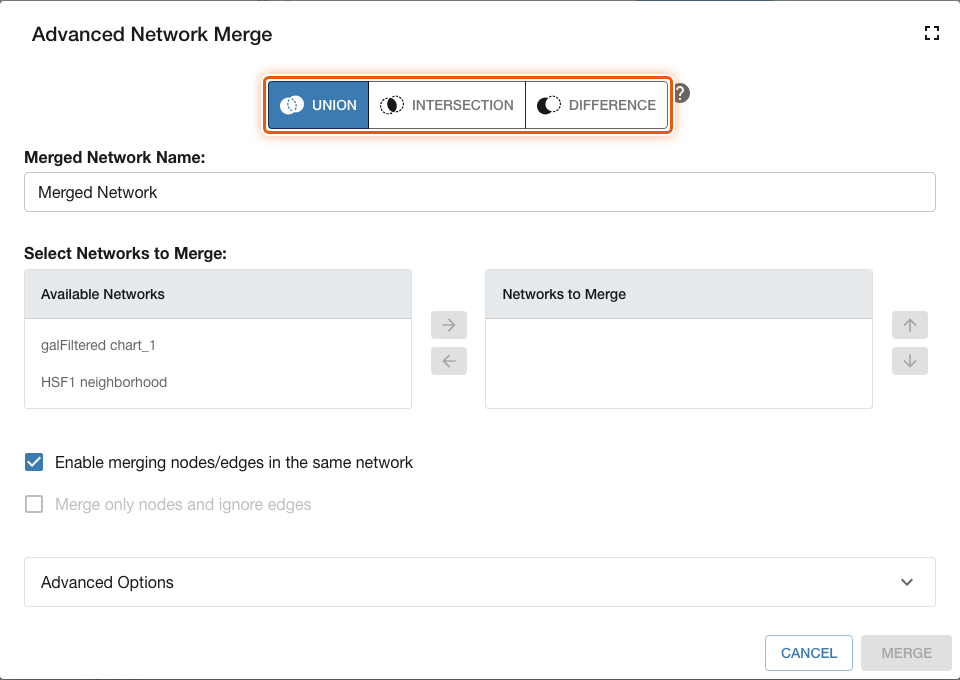
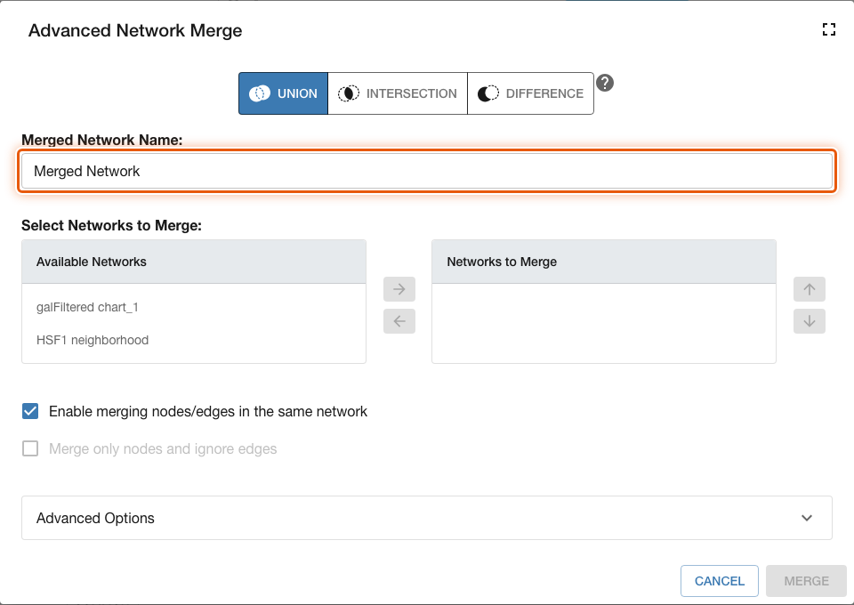
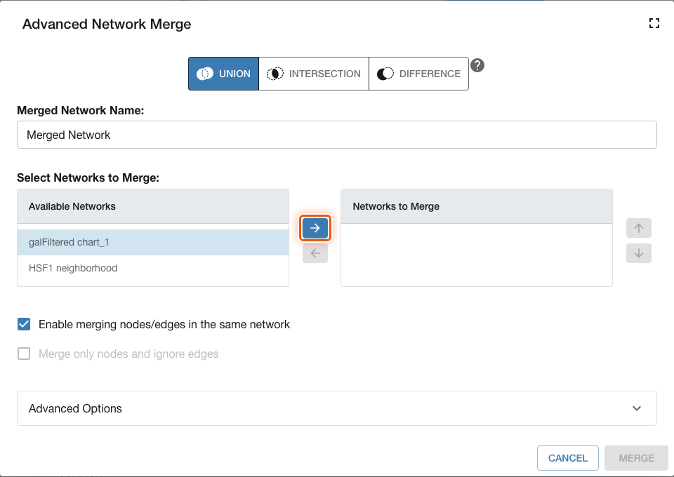
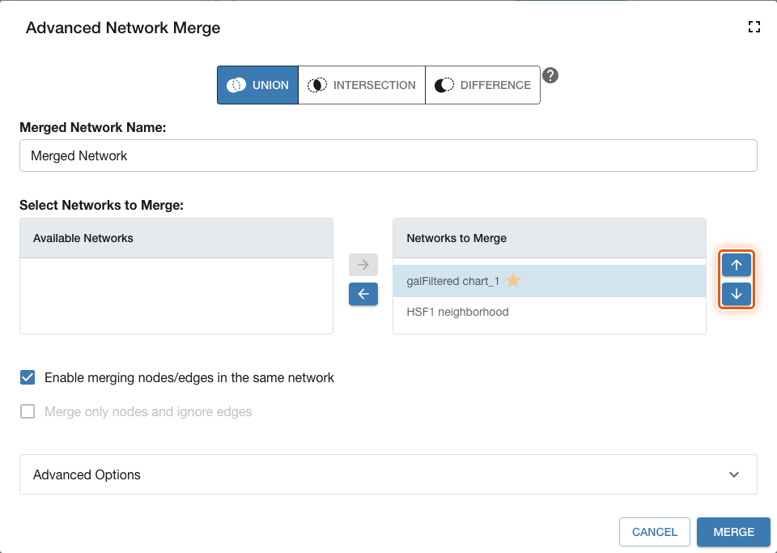
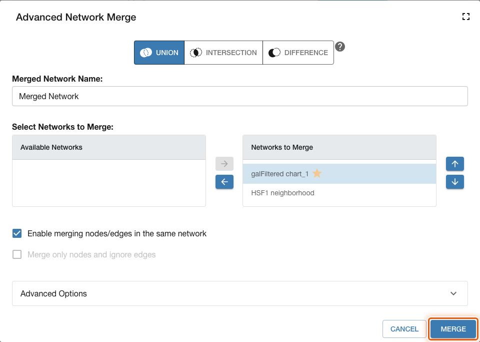
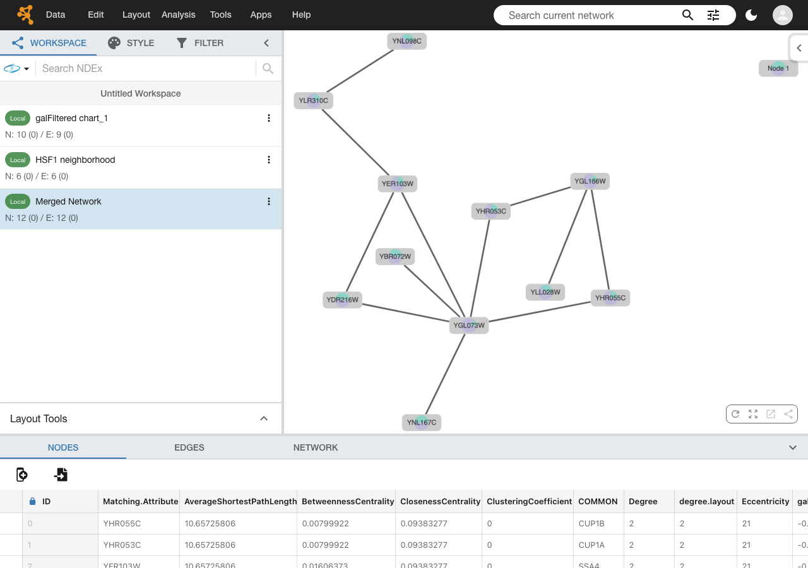

# Merging Networks

(Merge-merge)=
Merging combines two or more networks in your workspace into a new network.
Nodes that represent the same thing in different networks, for example the
same gene, become one node. The source networks are not changed.

(Merge-merge_networks)=
## Merge Networks

Choose **Tools → Merge Networks**. The **Advanced Network Merge** dialog
opens. The button at its top right switches it to full screen and back.

### Merge Types

Choose one of three merge types at the top of the dialog:

| Merge type | Result |
| --- | --- |
| Union | Every node and edge from every network. Matching nodes and edges are combined into one. |
| Intersection | Only the nodes found in every selected network, and the edges found in every network between those nodes. Needs at least two networks. |
| Difference | The first network minus what it shares with the second. Needs exactly two networks. |

Hover over the help icon next to the buttons for a short reminder.

For Difference, a **Node Removal Rule** appears:

- **Only remove nodes if all their edges are being subtracted, too** — the
  default. A shared node stays when it still has an edge that is not in the
  second network. Edges found in both networks are removed.
- **Remove all nodes that are in the second network** — every shared node is
  removed, together with its edges.

(Merge-basic_operations)=
### Basic Operations

1. Choose **Tools → Merge Networks**.

   

2. Choose the merge type.

   

3. Under **Merged Network Name:**, keep the suggested name (**Merged
   Network**) or type another. A warning appears when a network with that
   name is already in your workspace.

   

4. Under **Select Networks to Merge:**, click a network in **Available
   Networks** and click the right arrow to move it to **Networks to Merge**.
   Do the same for each network to merge. The left arrow moves a network
   back.

   

5. The first network in Networks to Merge is the base network, marked
   with a star. Select a network and use the up and down arrows to change
   the order.

   

6. Click **Merge**.

   

7. The merged network is added to your workspace and opens as the current
   network.

   

The merged network uses the base network's style, version and description. Its
network properties come from all the source networks. It is a local network
until you save it to NDEx.

The Merge button stays disabled until the selection fits the merge type. Hover over
it to see why.

(Merge-matching_nodes)=
### How Nodes and Edges Are Matched

Two nodes match when they have the same value in their network's matching
column. By default this is the **name** column. A network without a name
column uses its first node column. You can change the matching column under
[Advanced Options](#advanced-options).

Two edges match when they connect the same two matched nodes in the same
direction and have the same value in their **interaction** column.

When matched nodes or edges both have a value in the same column, the value
from the network higher in the Networks to Merge list is kept. List
values are combined, without repeats.

A warning icon next to a network in Networks to Merge means its matching
column holds the same value for more than one node. Pick a different matching
column, or keep the option below turned on.

### Merge Options

- **Enable merging nodes/edges in the same network** — on by default. Nodes
  with the same matching value inside one network are also combined into one
  node, and so are their matching edges. With this option on, a Union of
  a single network removes its duplicate nodes. Turn it off to keep them
  separate.
- **Merge only nodes and ignore edges** — off by default, and available only
  for Intersection. The result keeps the shared nodes, and every edge
  between them from any of the networks, not only the edges all networks
  share.

(Merge-advanced_options)=
## Advanced Options

Expand **Advanced Options** to control which columns match nodes and how
columns are combined.

### Matching Columns

**Matching Columns:** shows one drop-down per network in **Networks to
Merge**. Choose the node column that identifies nodes in that network. The
columns can have different names in different networks, for example
**name** in one and **GeneSymbol** in another.

### How to Merge Columns

**How to merge columns:** is a table with one row per column of the merged
network. Use the **Node**, **Edge** and **Network** buttons below it to
switch between node, edge and network columns.

Each row has:

| Column | What it holds |
| --- | --- |
| One drop-down per source network | The column whose values fill this row, or **None**. |
| Merged Network | The column's name in the merged network. |
| Type | The column's data type in the merged network. The list offers only types that every source column can be converted to. |

Columns with the same name in different networks start out on the same row.

In the Node view, the first row is the matching column. It is named
**Matching.Attribute** by default; rename it if you like. In the Network
view, the first three rows (name, version and description) cannot be renamed.

A row is shown in red when its source columns have conflicting types, its
name is empty, or its name repeats another row's. Hover over the row for the
reason. **Merge** stays disabled until every name is filled in and unique.
