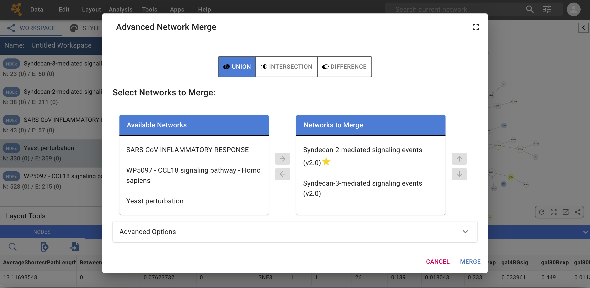
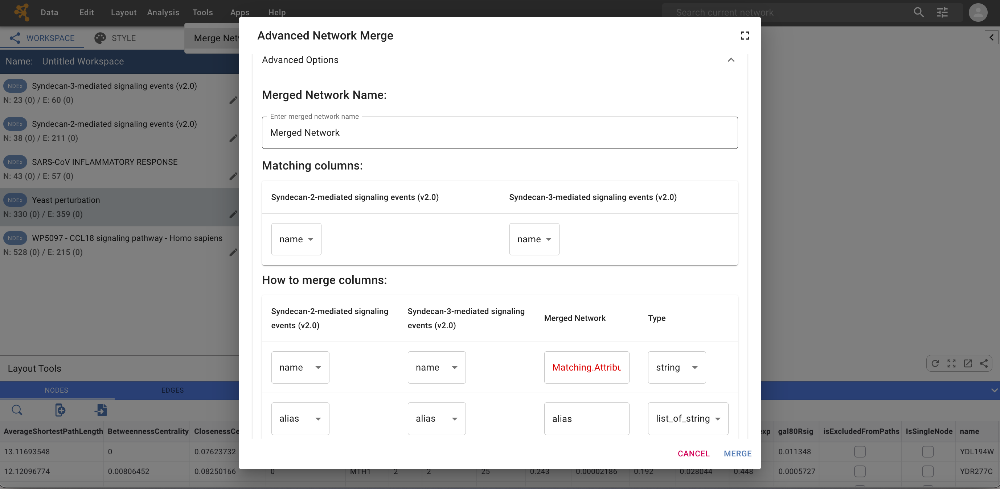
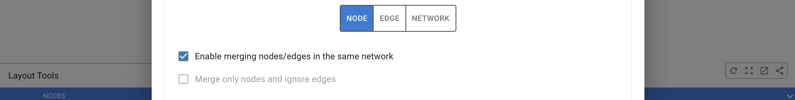

Merge Networks
====================

## Merge Networks

Cytoscape Web allows for merging networks, through **Tools → Merge Networks**. The **Advanced Network Merge** window is very similar to that of the Cytoscape desktop application and will be familiar to Cytoscape users; see [Merge](https://manual.cytoscape.org/en/stable/Merge.html) in the Cytoscape Desktop manual for more background. The **Tools** menu is available once your workspace contains a network.

### Basic Operations

-    With the buttons select either **Union**, **Intersection** or **Difference**. Click the **?** button next to them for a short explanation of each.

-    All the networks available to merge are listed under **Available Networks**.
     Select 2 or more networks from this list and click the right arrow to transfer
     them to **Networks to Merge** (the left arrow moves them back). The first network in **Networks to Merge** is marked with a star and is the base network; the other networks will 
     be merged into the base network. Use the up and down arrows to change the order, and so which network is the base network.

-    A **Difference** merge takes exactly 2 networks, and removes the second network from the first. Under **Node Removal Rule**, choose whether to remove a node only if all of its edges are removed too (the default), or to remove every node that is in the second network.

-    Click **Merge** to continue. The merged network will be displayed as a new network in your workspace, without a layout applied. If **Merge** is disabled, hover over it to see why.

Click the full-screen button in the window's title bar to enlarge the window.

### Advanced Options

The **Advanced Network Merge** window includes an expandable
**Advanced Options** panel, where you can specify the details of
how to merge the networks.

The options available here are:

-    **Merged Network Name**: here you can specify a custom name for the merged network. A warning appears if a network with that name is already in your workspace.

-    **Matching Columns**: this specifies, for each network, the column that should
     be used for merging. Typically, the **name** column is used as matching attribute.
     Alternatively, you can decide to use a different column that contains some other type of identifier.
     A warning appears if the values in a matching column are not unique.

-    **How to merge columns**: a table lets the user specify for each of
     the individual network columns, what the corresponding column in the
     merged network should be named as well as its data type.

     Buttons below the table, allow to further specify how to merge columns for **Node**, **Edge** and **Network** attributes individually.

Additional checkboxes let you further specify the merging behavior:

**Enable merging nodes/edges in the same network**
-   This option is active by default and available for all 3 types of merge (Union, Intersection, Difference).
-   It allows to merge nodes within each network, in case they have the same value for the selected *matching attribute*.
-   This makes it possible to perform a network merge even when selecting *only 1 network*.
-   If you don't want to merge nodes within each network, you should disable this option.

**Merge only nodes and ignore edges**
-   This option is disabled by default and can only be used in an Intersection merge.
-   If you are interested in retrieving only the nodes that are shared between 2 or more networks, you should enable this option.

Data in the networks that Cytoscape Web doesn't display itself (for example, data added by other applications to a CX2 file) is kept in the merged network.
