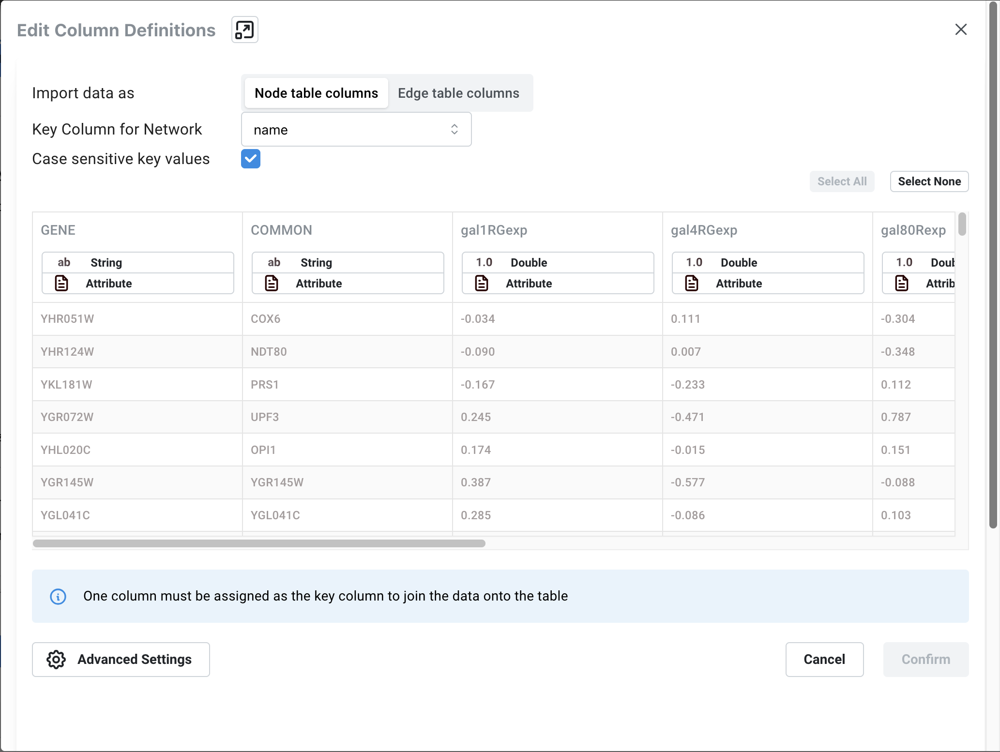
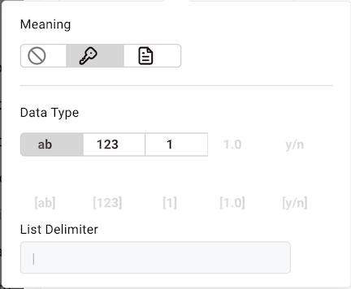
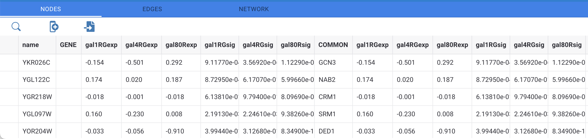

Node and Edge Column Data
========================================

Interaction networks are useful as stand-alone models but they are
most powerful for answering scientific questions when integrated with
additional information. Cytoscape Web allows the user to add arbitrary node,
edge and network information as node/edge/network column data. This could include, 
for example, annotation data on a gene or confidence values in a protein-protein 
interaction. These column data can then be visualized in a user-defined way by setting up a mapping
from columns to network attributes (colors, shapes, and so on). The
section on **[Styles](Styles.md#styles)** discusses this in greater detail.

Column data works the same way as in Cytoscape Desktop; see [Node and Edge Column Data](https://manual.cytoscape.org/en/stable/Node_and_Edge_Column_Data.html) in the Cytoscape Desktop manual for more background.

## Import Data Table Files

Cytoscape Web offers support for importing data from delimited text data tables (.csv, .txt or .tsv files, smaller than 5 MB).

***Sample Data Table 1***

<table cellspacing="0" style="table-layout: fixed; dwidth: 500px">
<caption style="width: 500px">Sample Data</caption>
<tr> <th class="">GENE</th>  <th class="center">COMMON</th>        <th class="center">gal1RGexp</th>  <th class="center">gal1RGsig</th></tr>
<tr> <th class="spec">YHR051W</th>    <td class="">COX6</td>       <td class="">-0.034</td>    <td class="">0.37</td></tr> 
<tr> <th class="specalt">YHR124W</th> <td class="alt">NDT80</td>    <td class="alt">-0.09</td> <td class="">0.27</td></tr>
<tr> <th class="spec">YKL181W</th>    <td class="">PRS1</td> <td class="">-0.167</td>    <td class="">0.0062</td></tr>
</table>
 

The data table file should contain a primary key column and at least one
data column. The number of data columns is unlimited, and the first row of
data can be used as column names. Alternatively, you can specify each column name
from the **Data → Import → Table from File...** interface.

### Basic Operation

1.  Load your network via **Data → Open Network(s) from NDEx...**, or **Data → Import → Network from File...** in the **Menu Bar** (see [Creating and Saving Networks](Creating_Networks.md#creating_networks)).

2.  Select **Data → Import → Table from File...**.
    Alternatively, you can click the **Import table from file...** button  in the **Table Panel**.

3.  In the **Upload Tabular Data File** window, drag a data file into the window or click **Browse** to choose it. If some rows of the file can't be read, a window lists the problems; click **Confirm** to continue anyway.

4.  The **Edit Column Definitions** interface will open:

5.  First, select where you want to import your data to under **Import data as**, either **Node table columns** or **Edge table columns**.

6.  Next, designate which column in your network contains the **Key** to be used to map the network to the data under **Key Column for Network**. Check **Case sensitive key values** if upper and lower case letters must match exactly.

7.  To select a **Key** column in the data file, click on the column header, and click the key icon under **Meaning** in the pop-up interface. Make sure the column designated as key matches the key in the network. Other columns can be imported as an **Attribute**, or skipped with **Not imported**. **Select All** and **Select None** import all columns or none.

8.  Similarly, to change the data type of a column, for example from integer to string, click the column header and select the correct data type under **Data Type**.
    
9.  The **Advanced Settings** let you choose the file and decimal delimiters, skip one or more of the first rows of data, and specify if the first row contains column names (see [Advanced Settings](Creating_Networks.md#advanced_settings)).

10. A message at the bottom of the interface tells you how many rows of data will be joined to your network's table. Click **Confirm** to import.

### Table Panel

The **Table Panel** at the bottom of the window shows your network's data. It has 3 tabs, **Nodes**, **Edges** and **Network**. Click the arrow button on its right side to close or open the panel.

Consistently with the behavior in the Cytoscape desktop application, when no nodes are selected in the network view, the **Nodes** tab shows the data of all nodes in the network. When one or more nodes are selected in the network view, it only shows the data for the selected nodes, and the tab shows how many, for example **Nodes (3)**. The **Edges** tab works the same way.

-   The first column, **ID**, shows each node's or edge's internal identifier (edge IDs start with *e*). In the **Edges** tab, the **Source Node** and **Target Node** columns show the nodes each edge connects. These columns are shown in gray and can't be edited.

-   To see a column's data type, hover over its header.

-   The columns in the **Table Panel** can be moved by clicking on the column header and dragging it to the desired location, and resized by dragging the edge of the header.

-   Use the checkboxes on the left to select rows. You can select several cells or rows by dragging, or by combining mouse clicks with the **Shift** or **Command**/**Ctrl** key.

#### Editing Values

-   To edit a cell, double-click it (or select it and press **Enter**, or just start typing). Once finished
editing, press **Enter** or click outside of the editing cell to save your edit. Pressing **Esc** while editing cancels the edit.
-   Boolean values are shown as checkboxes; click to change them.
-   Values that don't match the column's data type are not saved; for example, a decimal number typed into an Integer column is ignored.
-   You can copy and paste cell values, including blocks of cells, with the usual keyboard shortcuts.
-   Edits can be undone with **Edit → Undo** (see [Edit](Quick_Tour_of_Cytoscape.md#edit)).

#### Editing Lists

Cells in list columns (for example, a *List of strings*) open the list editor, **Edit list:** followed by the column name, when you double-click them. The editor has two tabs:

-   **Paste**: paste or type a list of items. Choose the **Separator** between items, or let Cytoscape Web detect it (**Auto-detect**). A preview shows how the text will be split; invalid items, such as text in a list of numbers, are shown in red. Click **Replace** to replace the list with the new items, or **Append** to add them to the end.

-   **Manual**: edit the items one by one. Click **Add item** to add an item, or the remove button next to an item to remove it, and click **Save**.

#### Table Tools

Above the column headers are the **Table Tools**. Some are always available, and others appear when you select a column, a cell or a row:

-    **Insert new column**: opens the **Create New Column** window, where you specify the **Column Name**, its **Data type** and an optional **Default value** for all rows.
-    **Import table from file...**: imports a data table (see [Import Data Table Files](Node_and_Edge_Column_Data.md#import_data_table_files)).

When you select a column by clicking its header:

-   **Sort Asc** and **Sort Desc** sort the rows by that column  .
-   **Duplicate** creates a copy of the column.
-   **Edit Column Name** renames the column .
-   **Delete Column** removes the column from Cytoscape Web completely, not just from the **Table Panel** .

If a style mapping uses the column you rename or delete, Cytoscape Web asks whether to update the mapping, delete it, or leave it as is.

When you select a cell:

-   **Apply Value to Column**: applies the value of the selected cell to all cells in that column.
-   **Apply Value to Selected Nodes** (or **Edges**): applies the value of the selected cell to all the nodes (or edges) shown in the table, that is, the ones selected in the network view.

   ***NOTE: If no nodes are selected in the network view, the table shows all nodes, so Apply Value to Selected Nodes changes every row. These changes can be undone with Edit → Undo.***

When you check one or more rows:

-   **Select Nodes** (or **Select Edges**): selects the corresponding nodes (or edges) in the network view.

#### Right-click Menu

Right-click a cell to open a menu with these actions:

-   **Apply to entire column** and **Apply to selected nodes** (or **edges**): the same as the Table Tools above.
-   **Copy** and **Paste**: copy or paste the cell's value. **Copy Selected** copies all selected cells.
-   **Copy Node ID** (or **Copy Edge ID**): copies the element's ID.
-   **Select This Node in Viewport** (or **Edge**): selects the element in the network view.
-   **Select nodes from selection** (or **edges**): selects, in the network view, the nodes (or edges) in the rows you selected in the table.

#### Network Tab

The **Network** tab shows information about the current network: its name and description, its NDEx information (owner, version, visibility, when it was created and modified, and its UUID) and its other properties. To change the network's name, description or properties, choose **Edit Network Properties** in the network's **⋮** menu in the [Workspace Panel](Quick_Tour_of_Cytoscape.md#workspace_tab).
