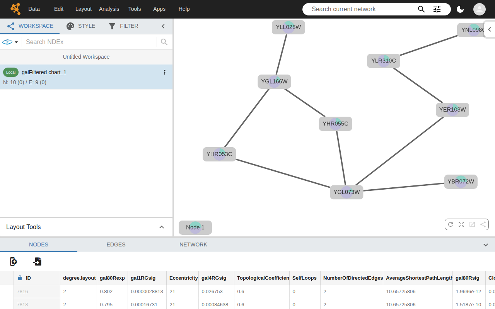

# Quick Tour

(Quick_Tour_of_Cytoscape-quick_tour_of_cytoscape_web)=
This page names the areas of the Cytoscape Web screen and the page that
describes each one.

When your workspace is empty, the network area shows **Welcome to Cytoscape
Web** with four buttons: **Open Sample Networks**, **Import from file**,
**Load from NDEx** and **Take a tour**. Open Sample Networks loads a set of
example networks from NDEx, so you can try every feature right away.

The first time you open Cytoscape Web, a welcome dialog explains the main
ideas: workspace, networks, styles, tables and hierarchies. Choose
**Take the tour** for a guided walk through the interface, or **Explore on my
own** to close it. You can start the tour again at any time from
**Help → Take a tour**.

When a network is loaded, Cytoscape Web looks similar to this:

The screen has four areas:

| Area | What it is for |
| --- | --- |
| Menu bar, across the top | The menus and, at the right, the search box, the light/dark mode button and the sign-in button. See [Menus and Toolbar](Menus.md). |
| Side panel, on the left | The tabs **WORKSPACE**, **STYLE** and **FILTER**. WORKSPACE lists the networks in your workspace. Only one of them is shown at a time: the *current* network. See [Workspace and Side Panel](Workspace_Panels.md). |
| Network view, in the middle | Draws the current network. See [Network View](Network_View.md). |
| Table panel, at the bottom | Shows the data columns of the nodes, edges and network. See [Node and Edge Column Data](Node_and_Edge_Column_Data.md). |

Drag the borders between areas to resize them. The side panel and the table
panel each have a **Close panel** button. It hides the panel and gives the
network view more room.

A second panel on the right holds the
**{ref}`Sub Network Viewer <Network_View-cell_view>`** and panels added by apps.
Open it with the arrow button (**Open panel**) at the top right of the
window.

(Quick_Tour_of_Cytoscape-tables)=
## Tables

(Quick_Tour_of_Cytoscape-table_panel)=
### Table Panel

The table panel shows and edits the network's data in three tabs: **Nodes**,
**Edges** and **Network**. Each column is an attribute of the nodes or edges,
such as a gene name or an expression value. When nodes are selected, the
Nodes table lists only those, and the tab shows how many, for example
Nodes (12). The Edges table works the same way.

Above the columns,

**Insert new column** adds a column, and

**Import table from file...** adds columns from a table file. For editing
cells, sorting, list values, the right-click menu and importing tables, see
[Node and Edge Column Data](Node_and_Edge_Column_Data.md).

## Where to Go Next

- [Creating and Saving Networks](Creating_Networks.md) — open, import and save
  networks.
- [Styles](Styles.md) — change how nodes and edges look.
- [Filters](Filters.md) — find nodes and edges by their data.
- [Menus and Toolbar](Menus.md) — what each menu item does.
