Quick Tour of Cytoscape Web
========================================

This chapter describes the basic layout and mechanics of using Cytoscape Web. When you start Cytoscape Web for the first time, the interface will look like the image below:

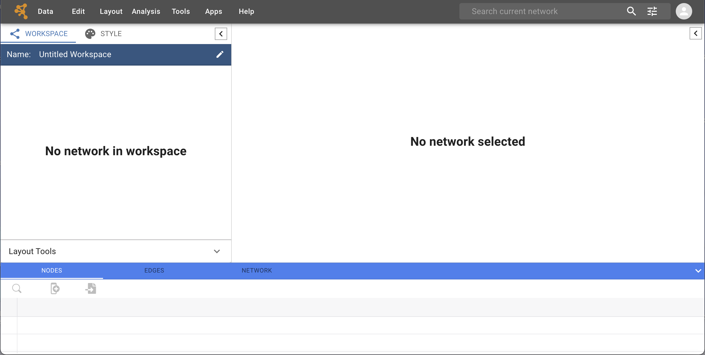

The interface layout is very similar to that of the Cytoscape desktop application (see the [Quick Tour of Cytoscape](https://manual.cytoscape.org/en/stable/Quick_Tour_of_Cytoscape.html) in the Cytoscape Desktop manual), with the **Control Panel** on the left, the **Table Panel** at the bottom and the **Network View Panel** in the center.

When a network is loaded, Cytoscape Web will look similar to the image
below:

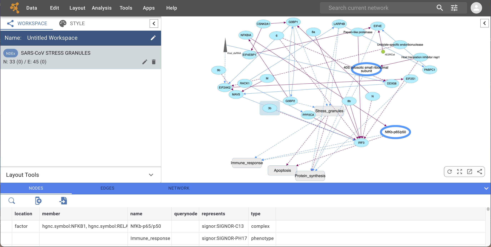

Most functionalities are self-explanatory, but we'll go through a
concise explanation of the interface components for clarity.

-   The **[Menu Bar](Quick_Tour_of_Cytoscape.md#menu_bar)** is at the top of the screen and contains several options (see below for more information about
    each menu). Also in the Menu Bar, to the right, are the **[Search Tool](Quick_Tour_of_Cytoscape.md#search_tool)**, the **[Dark Mode](Quick_Tour_of_Cytoscape.md#dark_mode)** button and the **[Sign In](Quick_Tour_of_Cytoscape.md#login)** button.

-   The **Control Panel** on the left has up to 4 tabs: **[Workspace](Quick_Tour_of_Cytoscape.md#workspace_tab)**, where all the networks you are working with are listed; **[Style](Quick_Tour_of_Cytoscape.md#style_tab)**; **[Filter](Quick_Tour_of_Cytoscape.md#filter_tab)**; and, for hierarchical networks, **[LLM Query](Quick_Tour_of_Cytoscape.md#llm_query_tab)**.
    You can have several networks in your workspace, but only one of them can be selected and displayed at any given time; this is called the 'current' network.
      
-   The **[Network View Panel](Quick_Tour_of_Cytoscape.md#network_view)** displays the current network. At the bottom right corner
    of the network view are a set of network view tools; mouse over for more information on each tool. 

-   The full-width **[Table Panel](Quick_Tour_of_Cytoscape.md#table_panel)** uses the bottom portion of the screen and displays columns of data
    for nodes and edges in your network. The table also allows you to modify the values of
    column data.

-   A panel on the right side of the window shows the **[Sub Network Viewer](Quick_Tour_of_Cytoscape.md#cell_view)** for hierarchical networks, and panels added by [Apps](Extending.md).

The Control Panel, Table Panel and right panel can be resized according to your preference or even fully collapsed 
to maximize the screen space available for the Network View Panel.

## Getting Started

### Welcome and Guided Tour

The first time you open Cytoscape Web, the **Welcome to Cytoscape Web** window introduces its main concepts: the workspace, networks, visual styles, tables, and hierarchies and analysis. Use **Back** and **Next** to move between them. Then click **Take the tour** for a guided tour of the interface, or **Explore on my own** to start working.

The guided tour points out the main parts of the window one by one. You can take it again at any time with **Help → Take a tour**. Some steps of the tour are skipped when no network is open.

When your workspace is empty, the center of the window offers buttons to **Open Sample Networks**, **Import from file**, **Load from NDEx**, or take the tour. If the sample networks can't be loaded, for example because NDEx can't be reached, click **Retry**.

### Working in Several Browser Tabs

You can open Cytoscape Web in several tabs of the same web browser. All tabs share the same workspace: changes you make in one tab, such as edits, styles, layouts and selections, appear in the others right away. Each tab can show a different network, and keeps its own panel layout and zoom level.

If you change the same thing in two tabs, the last change wins. If a tab shows the message *This tab is no longer receiving changes made in your other Cytoscape Web tabs*, reload it.

### Dialogs

Dialog windows close only with their own buttons, such as **Cancel**, **Close** or **Confirm**. Clicking outside a dialog or pressing **Esc** doesn't close it, so you don't lose your settings by accident.

## The Menu Bar

The Menu Bar has 7 menus: **Data**, **Edit**, **Layout**, **Analysis**, **Tools**, **Apps** and **Help**. The **Edit**, **Layout**, **Analysis** and **Tools** menus are available once your workspace contains a network. [Service Apps](Extending.md#using_service_apps) can add their own items to any menu.

You can also use the menus with the keyboard: press **Tab** to move to the menu bar, use the arrow keys to move between menus and items, press **Enter** or **Space** to open a menu or choose an item, and **Esc** to close a menu.

### Data

As shown in the image below, the **Data** menu contains most basic file functionality:

   - **Open Network(s) from NDEx...**, **Open Workspace from NDEx...** and **Open Sample Networks**, for opening NDEx networks and workspaces
   - **Open Network in Cytoscape Desktop**, for sending the current network to the Cytoscape desktop application
   - **Import**, for importing networks and tables from files
   - **Duplicate Network**, for making a local copy of the current network
   - **Save Network to NDEx**, **Save Copy to NDEx**, **Save Workspace** and **Save Workspace As...**, for saving networks and workspaces to NDEx 
   - **Download Network File (.cx2)** and **Export**, for saving the current network as a file or an image
   - **Remove Current Network** and **Remove All Networks**, for removing networks from your workspace
   - **Clear Local Database**, for resetting your Cytoscape Web instance and starting over with a clean slate (see [Troubleshooting](Advanced.md#troubleshooting)).

For more details, please review the chapters on **[Creating and Saving Networks](Creating_Networks.md#creating_networks)** and **[Exporting Your Data](Export_Your_Data.md#export_your_data)**.

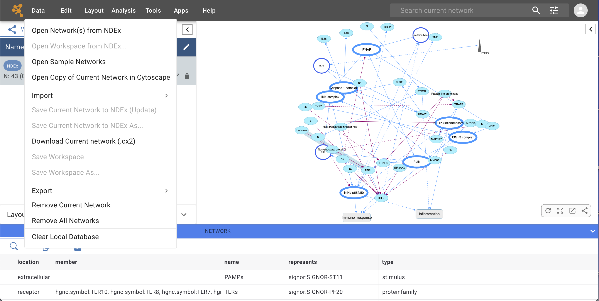

### Edit

The **Edit** menu allows to:

   - **Create Node**: add a new node to the current network, near the top left corner of the view.
   - **Create Edge**: add an edge between the first two of the selected nodes. At least 2 nodes must be selected.
   - **Delete Selected Nodes** and **Delete Selected Edges**: delete the currently selected nodes or edges of a network.
   - **Undo** and **Redo**: undo or redo your changes to the current network, such as edits, table changes, style changes and layouts. The menu item shows what will be undone or redone. Each network keeps its own history of the last 20 changes.

New nodes and edges have no data; add it in the [Table Panel](Node_and_Edge_Column_Data.md#table_panel). You can also create nodes and edges from the network's [context menu](Quick_Tour_of_Cytoscape.md#context_menus). Nodes and edges can't be created in hierarchical networks.

### Layout

The **Layout** menu lists a variety of layout algorithms that can easily be applied to your network with just 1 click.
Choosing any of these options will lay the network out using the default settings for that algorithm. In this version of Cytoscape Web, the available options are:

-    **Compound Spring Embedder Layout (CoSE)** (available for networks with up to 2,000 nodes and edges)
-    **Cosmos Layout** (GPU-based; it gives a slightly different result each time)
-    **gForce Layout** (force-directed)
-    **Circular Layout**
-    **Concentric Layout**
-    **Grid Layout**
-    **Radial Layout**
-    **Biological Flow Layout**: arranges pathway networks from left to right, following the direction of the signal flow
-    **Hierarchical Layout (DAGRE)**

The **Layout** menu also contains:

-    **Apply Default Layout**: applies the default layout (gForce, unless you change it).
-    **Layout Tools**: shows or hides the [Layout Tools](Quick_Tour_of_Cytoscape.md#layout_tools) panel.
-    **Settings...**: opens the **Layout Option Editor**, where you can select any available layout algorithm in the **Layout** dropdown and adjust its parameters. Check **Set as default** to make it the default layout, and click **Apply Layout** to apply it.

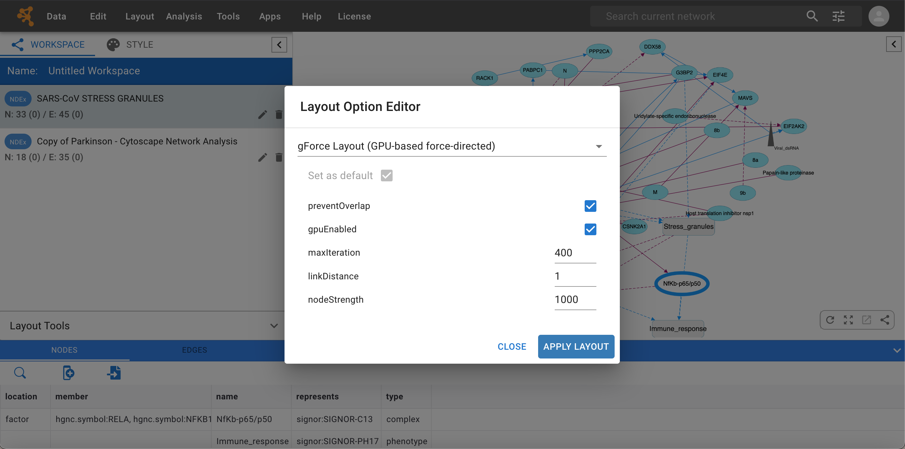

When you open a network that has no layout, Cytoscape Web lays it out automatically: with the default layout for networks with fewer than 1,000 nodes and edges, with the **Hierarchical Layout (DAGRE)** for hierarchies, and with the **Grid Layout** for larger networks. Very large networks are not laid out automatically.

For more about layouts, see [Navigation and Layout](https://manual.cytoscape.org/en/stable/Navigation_and_Layout.html) in the Cytoscape Desktop manual.

### Analysis

The **Analysis** menu contains features to analyze your networks. Service Apps can add more analysis tools to this menu.

**Run LLM Query** leverages Large Language Models (LLMs) to analyze a list of genes and provide details about their involvement in known biological processes. In this version of Cytoscape Web, the LLM Query analysis is only available for hierarchical networks (HCX networks), whose nodes are systems or "communities" of genes, such as the MuSIC sample network. Select a system in the network, and choose **Analysis → Run LLM Query**. The genes of the selected system are sent to the LLM, and the result appears in the **[LLM Query](Quick_Tour_of_Cytoscape.md#llm_query_tab)** tab of the Control Panel. If the menu item is disabled, mouse over it to see why.

Choosing **Analysis → LLM Query Options...** lets you choose the LLM used for the analysis:

-   **Provider**: **OpenAI**, a model running on your own computer with **Ollama (local)**, or any other service that works like OpenAI's, with **Custom (OpenAI-compatible)**.
-   **Endpoint URL** (for Ollama and Custom providers): the address of the service. For Ollama, the default is *http://localhost:11434/v1*. The help text below the field explains how to set up Ollama to accept requests from Cytoscape Web.
-   **LLM Model**: type the name of the model, or choose one of the suggestions. For Ollama and Custom providers, click the refresh button to list the models available at the endpoint.
-   **OpenAI API Key** (for OpenAI) or **API Key** (optional, for Custom providers): the key for your account with the provider. For more information about obtaining an OpenAI API key, please refer to [this guide](https://www.howtogeek.com/885918/how-to-get-an-openai-api-key/#how-to-get-an-openai-api-key).
-   **Prompt**: the prompt template to use. You can preview or copy the prompt.

Click **Confirm** to save your choices.

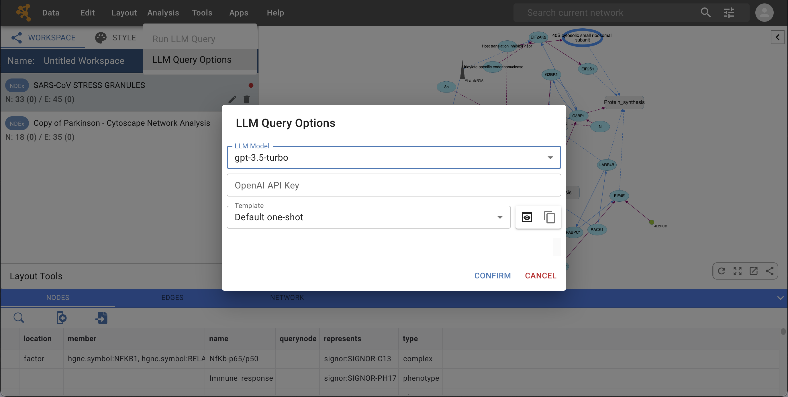

***NOTE: Commercial LLMs such as OpenAI's are paid services, billed to your account based on usage. Your API key is sent only to the provider you chose, and only over a secure connection (https) or to your own computer. Your LLM settings, including your API key, are kept only until you reload or close Cytoscape Web.***

### Tools

The **Tools** menu contains advanced features like **[Merge Networks](Merge.md#merge)**. Service Apps can add more tools to this menu.

### Apps

The **Apps** menu contains **Manage Apps...**, which opens the App Manager, and the menu items of the Apps and Service Apps you have installed. For more information about Apps and Service Apps, please review the chapter on **[Extending Cytoscape Web](Extending.md)**.

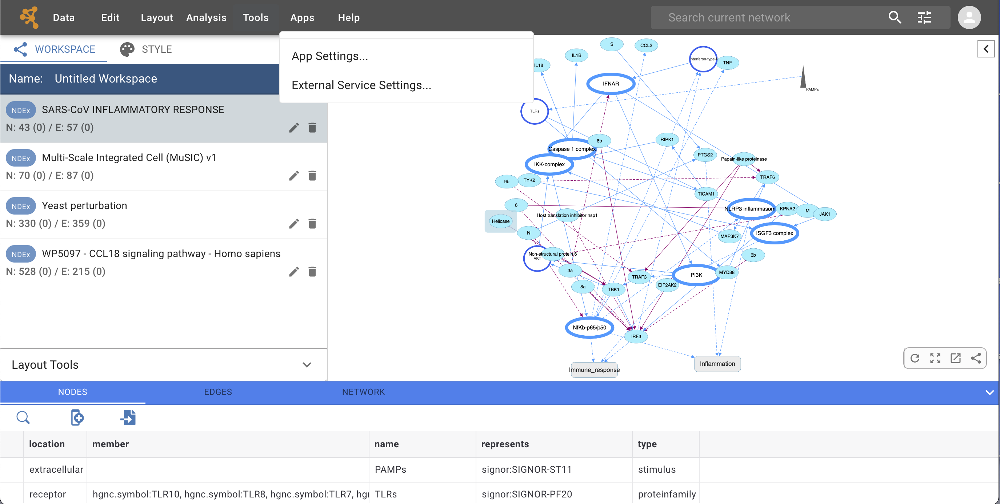

### Help

The **Help** menu contains:

-   **About Cytoscape Web**: the version of Cytoscape Web (click it to see the release notes) and build information. Click **Copy** to copy this information, for example for a bug report.
-   **Take a tour**: starts the [guided tour](Quick_Tour_of_Cytoscape.md#welcome_dialog).
-   **User Manual**: opens this manual.
-   **Developer**: links to the **Developer's Guide** (see [Developing Apps](Developing_Apps.md)) and the **Code Repository**, and options to export and import a snapshot of your local database, for troubleshooting.
-   **License**: the license of Cytoscape Web.
-   **Citation**: the literature citations for Cytoscape Web and Cytoscape. Click **Copy Both Citations** to copy them.
-   **Report a Bug**: opens the bug report form (see [Reporting a Bug](Advanced.md#report_a_bug)).

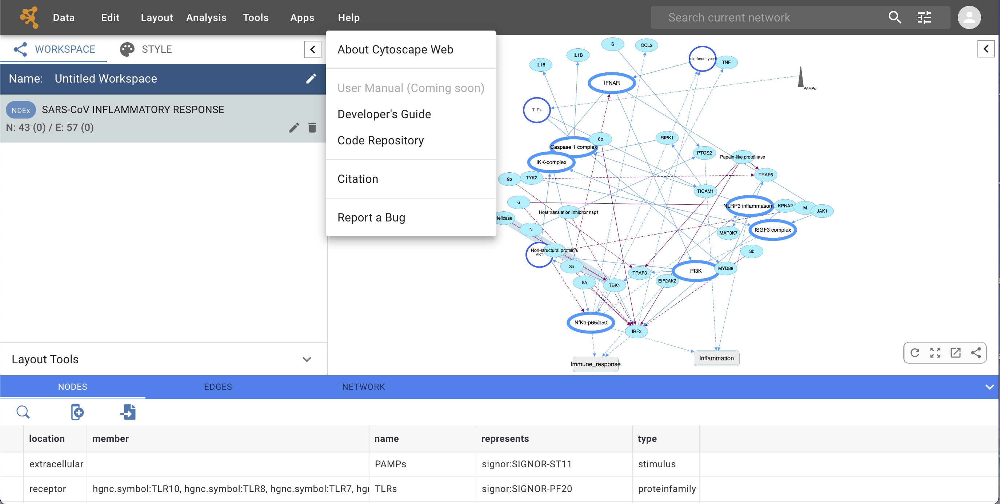

### Search Tool

The **Search Tool** lets you find nodes and edges in the current network using text-based search, similar to the [Search Bar](https://manual.cytoscape.org/en/stable/Finding_and_Filtering_Nodes_and_Edges.html#search-bar) in Cytoscape Desktop. Type one or more search terms in the **Search current network** field and press **Enter** or click the search button; the matching nodes and edges are selected. Mouse over the field for search examples. Click the trash button to clear the search and the selection.

Searches look at text columns (and lists of text) and are ***case insensitive***. Click  in the **Search Tool** to reveal the search settings:

-    **Operator**: whether results must match all of the search terms (*AND*) or any of them (*OR*).
-    **Search Target**: search **Nodes**, **Edges**, or both.
-    **Search Mode**: with **Exact Match**, a value must match a search term exactly; with **Contains**, a value only needs to contain it.

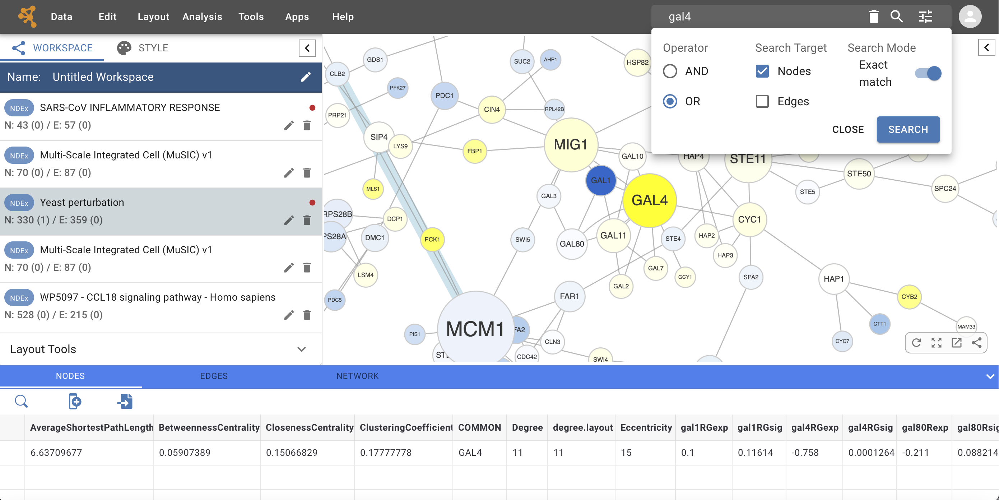

By default, searches are performed on *nodes*, using the *OR* operator and **Exact Match**. So, in the example above:

-    Searching for "gal4" will find the specified node
-    Searching for "gal" will return no results.

If you choose **Contains**:

-    Searching for "gal4" will find the specified node
-    Searching for "gal" will find all the nodes whose name contains "gal", including Gal4.

### Dark Mode

Cytoscape Web follows your computer's light or dark appearance setting. To switch between light and dark mode, click the moon or sun button to the right of the **Search Tool**. Once you use this button, Cytoscape Web keeps your choice.

### Sign In Button

At the far right of the menu bar, the  icon allows you to sign in to your Network Data Exchange (NDEx) account (if you already have one) or register for one. Your NDEx account acts as the official "Cytoscape Ecosystem Account", and provides a secure, unified sign-in experience across existing and future Cytoscape ecosystem's applications and services.

Click  to open the NDEx sign in page as shown below:

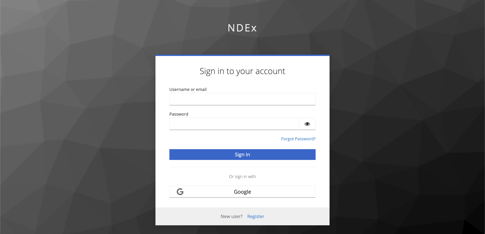

Here, you can:

-    **Sign in** to your existing NDEx account either by typing your username and password, or by using the convenient *Sign In with Google* option.
  
-    **Create a new NDEx account**. Again, the easiest/fastest way is to choose *Sign In with Google* to create a new account with just a few clicks. Alternatively, you can choose *Register* at the bottom of the screen, provide the required information and follow the instructions to activate your new NDEx account.

Once you are signed in, the button shows your initial. Click it to see your account name and to **Logout**.
 
***NOTE: even if you already have an existing NDEx account, the first time you sign in to link your NDEx account with Cytoscape Web, you will need to go through an email verification process. While this is a quick and simple procedure, it is recommended that you perform it using the same browser and device.***

## Network Management

### Workspace

In Cytoscape Web, the **Workspace** replaces the **Session** concept that Cytoscape desktop application users are familiar with. 
The Cytoscape Web **Workspace** allows multiple networks to be loaded, but only one can be displayed at any given time. 

An example where a number of networks have been loaded is shown below:

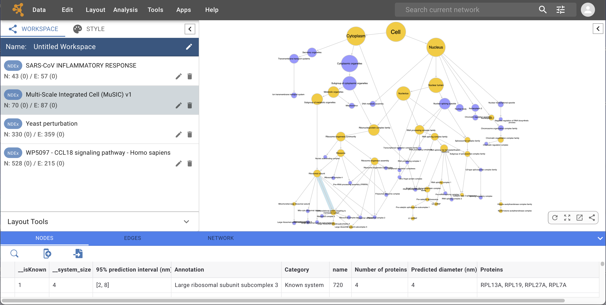

At the top of the **Workspace Panel** (**Workspace** tab in the Control Panel), the **Search NDEx** bar lets you search for networks in NDEx; type your search terms and press **Enter** to open the [NDEx network browser](Creating_Networks.md#open_network_from_ndex) with the results. Apps can add other search providers, which you can choose with the button at the left of the search bar.

Below it are the name of your workspace and all the networks that are
loaded. Clicking on a network here will display the network in the **Network View Panel**. Each network shows:

-   A label that identifies its provenance: **NDEx**  for networks stored in NDEx, or **Local**  for networks stored only on your computer, such as networks imported from a file.
-   Its name.
-   For a network opened from an NDEx folder, the folder it came from, as **Imported from:**.
-   Its size, as the number of nodes (**N**) and edges (**E**), with the number of selected nodes and edges in parentheses.

The **⋮** (**Network actions**) button next to each network opens a menu to save the network to NDEx, edit its name, description and properties (**Edit Network Properties**), open it in Cytoscape Desktop, duplicate it, download it as a CX2 file, export it as an image, share it, or remove it from the workspace. An orange dot on the **⋮** button means the network has unsaved changes. Some actions are only available for the current network.

A **Workspace** can be saved to NDEx and re-opened later, via the options available in the **Data** menu. For more information, please review the chapter on **[Creating and Saving Networks](Creating_Networks.md#creating_networks)**.

### Style

The **Style** tab of the Control Panel provides the interface to create and manage the visual styles associated with your networks, like the **Style** panel of the Cytoscape desktop application. A network can have several named styles; the style selector at the top of the tab shows the current one.

We recommend you review the chapter on **[Styles](Styles.md#styles)** for detailed information and examples.

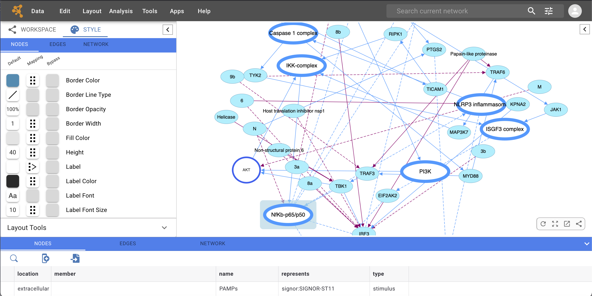

### Filter

The **Filter Panel** (FILTER tab in Control Panel) finds the nodes and edges that meet a set of conditions, based on their column values, their number of edges or their neighbors, and either selects them or shows only them.

As shown below, the **Filter Panel** works like the Filter tab of the Cytoscape desktop application, and the two applications can exchange filters through filter files. We recommend you review the chapter on **[Filters](Filters.md#filters)** for detailed information and examples.

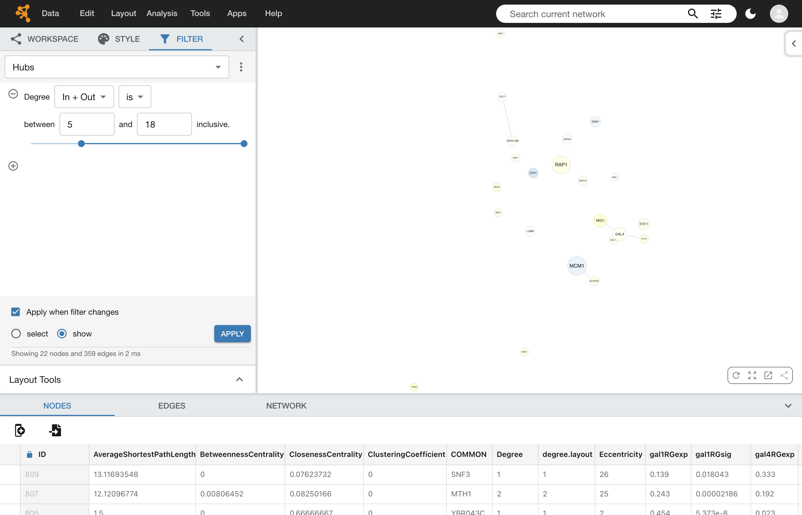

### LLM Query

For hierarchical networks, the **LLM Query** tab shows the result of **[Analysis → Run LLM Query](Quick_Tour_of_Cytoscape.md#analysis)**. The **Gene Query** field shows the genes that were sent to the LLM; you can edit them and click **Regenerate response** to run the query again.

### Layout Tools

The **Layout Tools** let you adjust the size of the network's layout, like the [Node Layout Tools](https://manual.cytoscape.org/en/stable/Navigation_and_Layout.html#node-layout-tools) of Cytoscape Desktop. They are available in a panel below the Control Panel, which is collapsed by default and can be expanded by clicking it, and in a floating panel in the lower left corner of the network view, which you open with **Layout → Layout Tools**. 

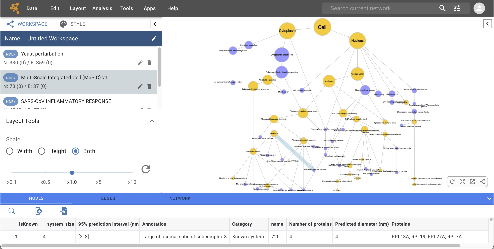

Under **Scale**, choose whether to scale the **Width**, the **Height** or **Both**, and move the slider to spread the nodes apart or bring them closer together (from x0.1 to x10). The positions of the nodes are scaled, not their sizes. The button on the right resets only the slider's position, allowing additional adjustments. Scaling can be undone with **Edit → Undo**.

## Network Viewer

### Network View Panel

This is where your selected network is displayed and you can interact with it:

-   Scroll to zoom in and out, and drag the background to move the view.
-   Click a node or edge to select it. Hold **Shift** (or **Command**/**Ctrl**) and click to add or remove nodes and edges from the selection, or hold **Shift** and drag to select all the nodes and edges in a rectangle. Click the background to clear the selection.
-   Drag nodes to move them.

At the bottom right corner of the **Network View Panel**, 4 network view tools let users perform various operations as shown below:

  **Apply Default Layout** will apply the default network layout (*gForce*) or whatever other layout you have specified as default in the **[Layout Settings](Quick_Tour_of_Cytoscape.md#layout)**.

  **Fit Network to Window** will resize the current network and fit it to the **Network View Panel**.

  **Open in Cytoscape Desktop** will open a copy of the current network in the Cytoscape desktop application if it is running on your computer (default port: 1234). See [Open Network in Cytoscape Desktop](Creating_Networks.md#open_in_cytoscape_desktop).

  **Share Network** copies the URL of the current network to your computer's clipboard so you can paste it in emails and other documents. The URL also records how your window is set up, such as which panels are open and which nodes are selected (see [Display Parameters](Advanced.md#display_parameters)). Only networks stored in NDEx can be shared; save a local network to NDEx first.

### Context Menus

Right-click in the network view to open a context menu, like the [context menus](https://manual.cytoscape.org/en/stable/Navigation_and_Layout.html#context) of Cytoscape Desktop:

-   Right-click the background and choose **Create Node** to add a node where you clicked.
-   Right-click a node and choose **Create Edge from this Node**, then click the target node to create an edge between them. Click the same node to create an edge from the node to itself (a self-loop). Press **Esc** or click the background to cancel.

Apps can add their own items to these menus.

### Cell View

If the currently selected network is a *hierarchy*, the interface will allow you to choose how you want to display the network. At the top of the **Network View Panel**, you'll see two tabs: the standard **Tree View** and the new **Cell View**. Click it to switch to **Cell View**, also known as circle packing view:

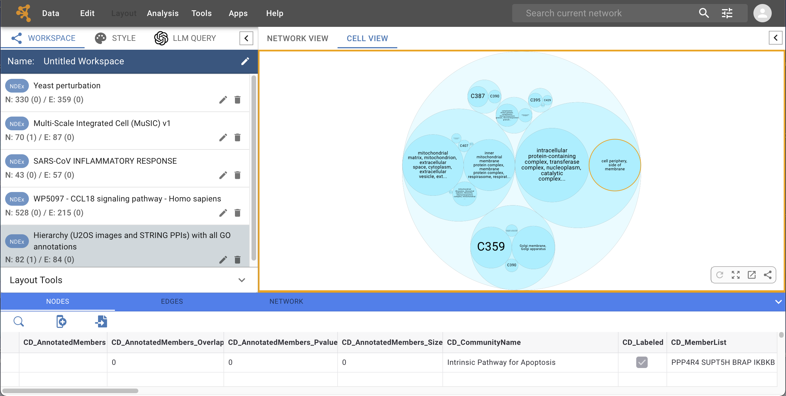

**Cell View** displays the network in systems (circles) that might or might not be nested.
A fair comparison is to think about this type of representation as Matryoshka dolls. Cell View is offered only for hierarchies that can be drawn this way.

Single click a system to select it. Double click it to zoom in and see the next-level systems (sub-systems). Scroll or drag to zoom and move the view, and click the background to clear the selection. Clicking a gene selects the system that contains it and highlights the gene.

When a system is selected, in either view, you can explore the underlying interaction network in the **Sub Network Viewer** panel on the right side of the window:

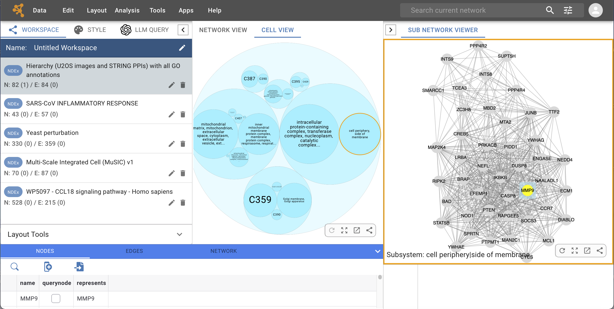

The **Sub Network Viewer** opens automatically when you display a hierarchy. Close it with the  button at its top left; when it's closed, open it again with the button at the right edge of the window. It has its own set of network view tools. Click the interaction network to make it the active view; it is then outlined, and the Table Panel shows its data.

Below the interaction network, a property panel shows the data of the selected node. Lists are shown as comma-separated values, missing values as *N/A*, and web addresses as links.

When the hierarchical model defines a filter for its interaction networks, for example to choose between several sources of interaction data, a filter panel is shown in the bottom part of the **Sub Network Viewer** panel. Use its switch to turn the filter on or off, and check the values you want to see (**Select All** and **Deselect All** check or clear them all). The colored squares next to the values match the colors used in the network.

If Cytoscape Web finds problems in a hierarchical network, a warning button appears in the Workspace Panel; click it to see the details.

## Tables

### Table Panel

At the bottom of the interface, the **Table Panel** allows you to view and modify your network's data. It has 3 tabs: **Nodes**, **Edges** and **Network**, that contain the data columns (also known as *attributes* or *properties*) for each of those elements.

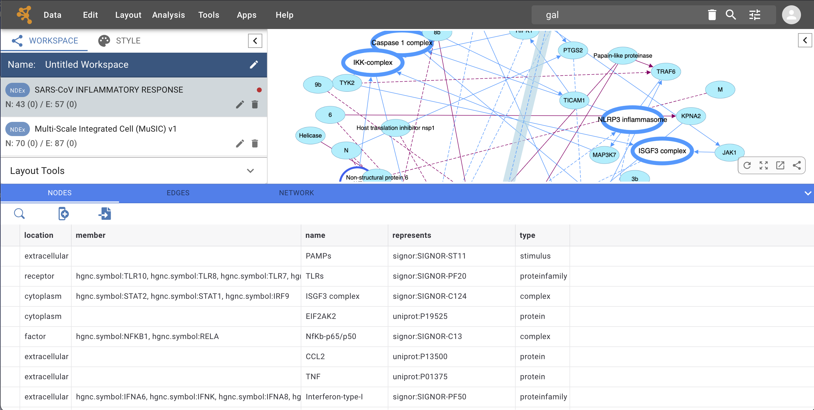

Consistently with the behavior in the Cytoscape desktop application, when no nodes are selected in the network view, the **Nodes** tab shows the data columns and values of all nodes in the network. When one or more nodes are selected in the network view, the **Nodes** tab only shows the data for the selected nodes.

Like other interface features, the **Table Panel** can be closed using the arrow button on the right hand side, or resized by dragging its top edge.

For detailed information on viewing and editing data, see the chapter on **[Node and Edge Column Data](Node_and_Edge_Column_Data.md#table_panel)**.
