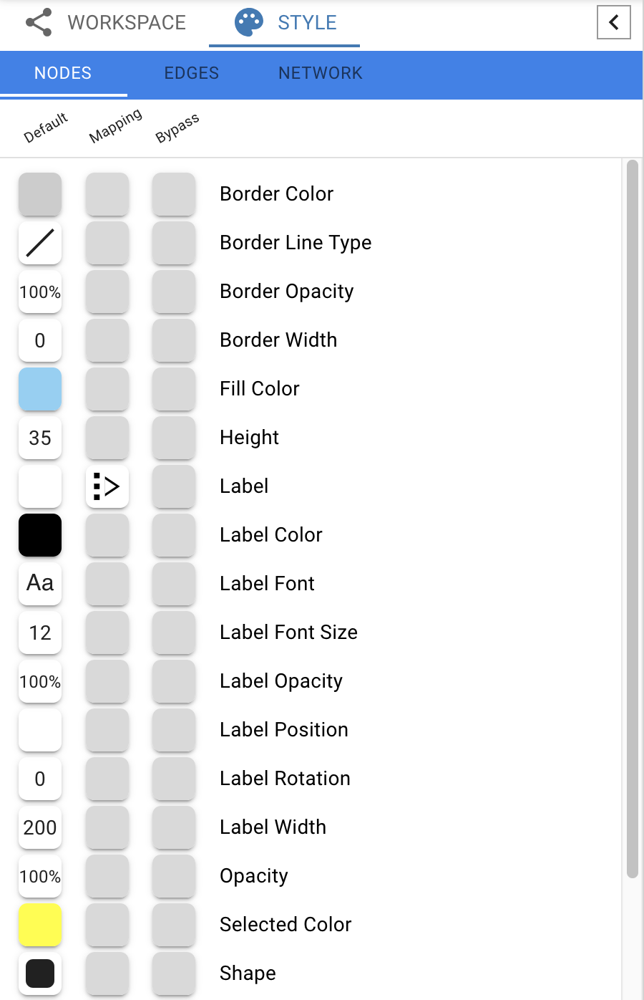
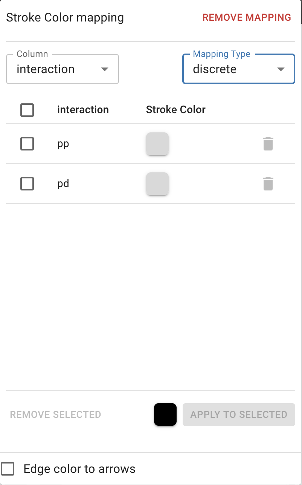
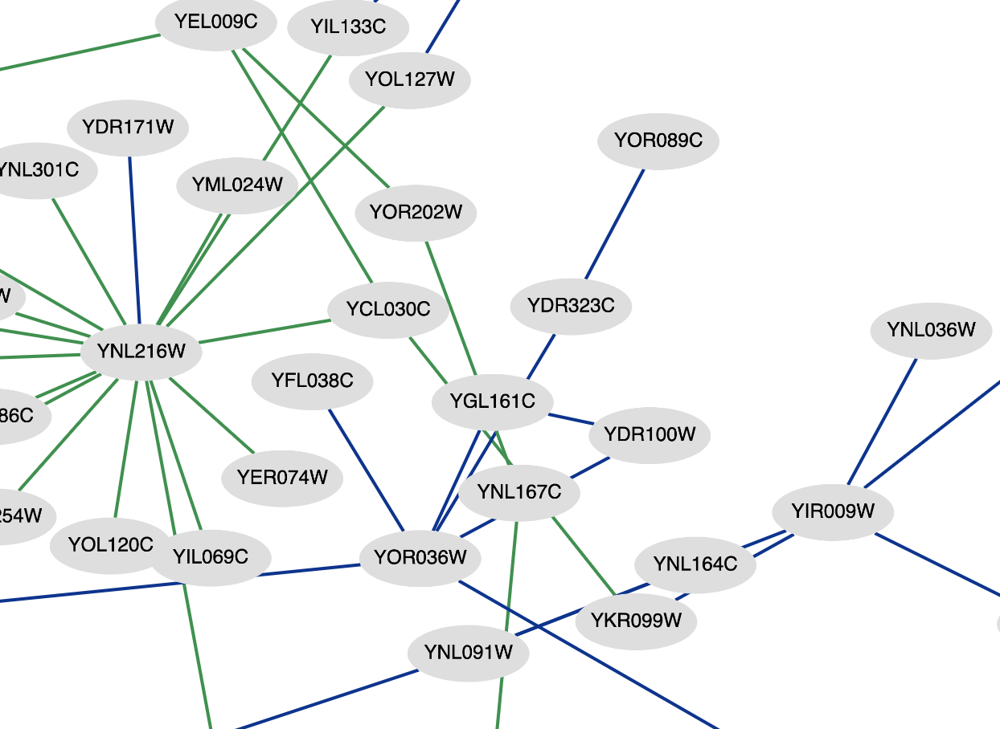
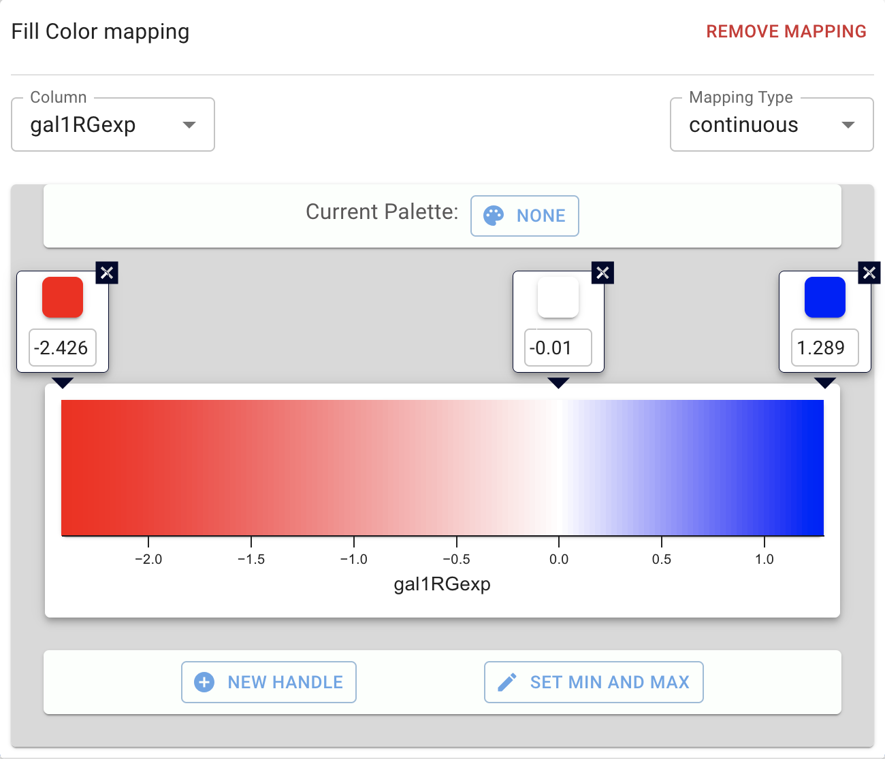
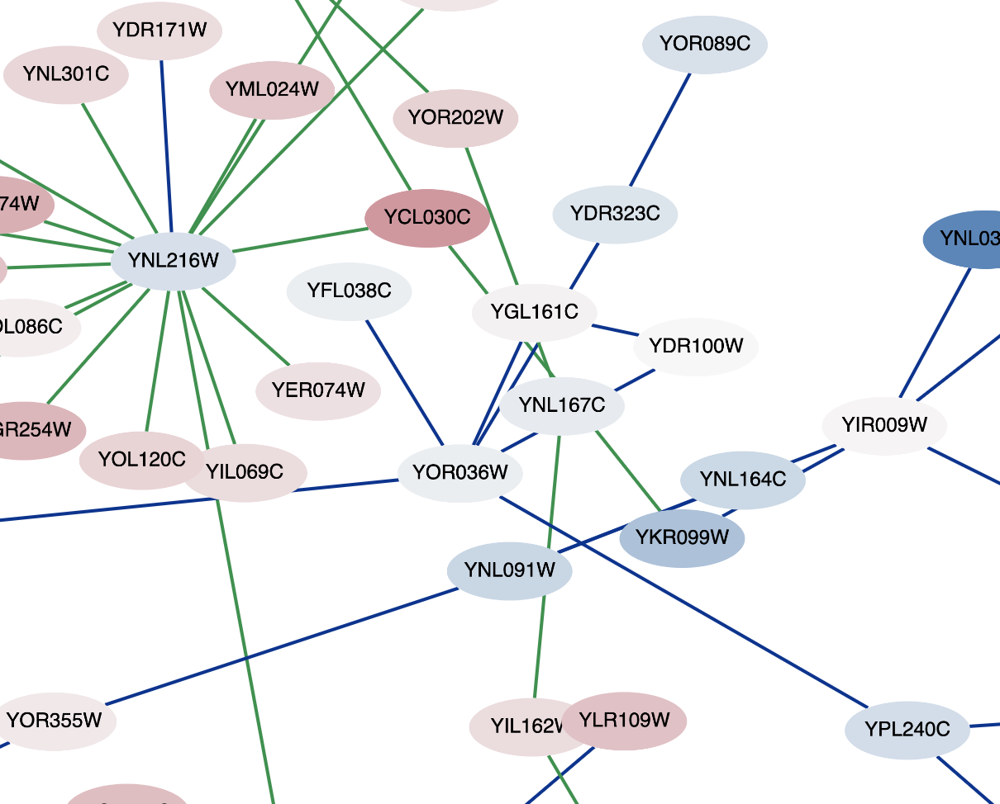

Styles
====================

A **Style** encodes your network's data (name, type, expression values and so on) as visual properties of its nodes and edges, such as color, shape, size or label. Styles in Cytoscape Web work the same way as in Cytoscape Desktop; see [What are Styles?](https://manual.cytoscape.org/en/stable/Styles.html#what-are-styles) in the Cytoscape Desktop manual for an introduction.

## Introduction to the Style Interface

The style interface is located under the **Style** tab of the
**Control Panel**.

-   At the top, the **style selector** shows the name and a small preview of the network's current style. Click it to switch to another style, and click the **⋮** (**Manage styles**) button next to it to create, rename or delete styles. See [Named Styles](Styles.md#named_styles).

-   The main area of the interface is composed of three tabs, for **Nodes**,
    **Edges** and **Network** properties.

-   Each tab contains a list of properties relevant to the
    current style, in alphabetical order (with **Image/Chart 1** last). Hover over a property name to see what it does.

-   Each property entry in the list has 3 columns:

    -   The **Default** shows just that, the default value for
        the property. Clicking on the **Default** column for any
        property allows you to change the default value.

    -   **Mapping** displays the type of mapping currently in use for
        the property. Clicking on the **Mapping** column for any
        property opens an interface for
        defining the mapping. Details on the mapping types are provided
        [here](Styles.md#how_mappings_work).

    -   **Bypass** displays any style bypass for a selected node
        or edge. Clicking on the **Bypass** column allows you to
        enter a bypass for that property for the selected node(s)/edge(s). See [Bypass](Styles.md#bypass).

The **Default Value** is used when no mapping is defined for a property,
or for nodes/edges not covered by a mapping for a particular property.
If a **Mapping** is defined for a property, this defines the style for
all or a subset of nodes/edges, depending on how the mapping is defined.
A **Bypass** on a specific set of nodes/edges will bypass and override
both the default value and defined mapping.

To pick a color, use the tabs of the color window: **ColorBrewer Sequential**, **ColorBrewer Diverging**, **Viridis Sequential**, **Swatches** or **Color Picker**, then click **Confirm**.

The windows for editing mappings and bypasses close only with their **Close** button, so you can keep them open while you work. Changes to default values, mappings and bypasses can be undone with **Edit → Undo**.

## Named Styles

A network can have several named styles, and you can switch between them to view the same network in different ways. A new network starts with a single style, called **Default**.

### Switching Styles

Click the style selector at the top of the **Style** tab to open the **Styles** window. It shows a preview of each style, drawn with nodes from your current network, in four sections:

-   **This Network**: the styles of the current network. Click one to make it the current style. Hover over a style and click its **⋮** button to rename, duplicate or delete it.
-   **Other Networks**: the styles of the other networks in your workspace. Click one to copy it into the current network and make it the current style; the original is not changed.
-   **Workspace Styles**: styles you saved for reuse (see [Workspace Styles](Styles.md#workspace_styles)). Click one to copy it into the current network.
-   **General Styles**: preset styles that come with Cytoscape Web. Click one to copy it into the current network.

Use **Search styles** to find a style by name. Switching styles can be undone with **Edit → Undo**.

The preset **General Styles** are:

<table cellspacing="0" style="table-layout: fixed; width: 500px">
<colgroup> <col style="width:150px"> <col style="width:350px"> </colgroup>
<tbody>
<tr> <th>Style</th>                               <th>Description</th></tr>
<tr> <th class="specalt">Minimal</th>            <td class="alt">Small pale nodes, faint edges</td> </tr>
<tr> <th class="spec">Directed</th>              <td>Arrowheads for directed graphs</td> </tr>
<tr> <th class="specalt">High Contrast</th>      <td class="alt">Heavy dark shapes for projectors</td> </tr>
<tr> <th class="spec">Dark</th>                  <td>Light nodes on a dark canvas</td> </tr>
<tr> <th class="specalt">Big Labels</th>         <td class="alt">Oversized text for figures</td> </tr>
<tr> <th class="spec">Outline</th>               <td>Unfilled nodes, colored borders</td> </tr>
<tr> <th class="specalt">Box</th>                <td class="alt">Square-cornered rectangles</td> </tr>
<tr> <th class="spec">Blueprint</th>             <td>Dashed edges, hexagonal nodes</td> </tr>
</tbody>
</table>
 

When you copy a style from another network, from Workspace Styles or from the General Styles, its bypasses are not copied.

### Creating, Renaming and Deleting Styles

Click the **⋮** (**Manage styles**) button next to the style selector:

-   **New Style (copy of current)…**: creates a new style, starting as a copy of the current style, and makes it the current style. Enter a name and click **Create**.
-   **Duplicate Current Style**: adds a copy of the current style, named *Copy of* followed by the style's name.
-   **Rename Current Style…**: renames the current style.
-   **Delete Current Style…**: deletes the current style, after you confirm. A network must have at least one style. Deleting a style can't be undone, and clears the network's undo history.
-   **Save Style to Workspace…** and **Apply Style from Workspace…**: see [Workspace Styles](Styles.md#workspace_styles).

A network can have up to 50 styles.

### Workspace Styles

**Workspace Styles** let you reuse a style with any network in your workspace:

1.  On the network whose style you want to reuse, choose **Save Style to Workspace…** in the **⋮** menu, check the name, and click **Save**.
2.  Open another network, and choose **Apply Style from Workspace…** in the **⋮** menu. In the **Workspace Styles** window, click **Apply** next to the style. You can also click the style in the **Workspace Styles** section of the **Styles** window.

The **Workspace Styles** window also lets you rename and delete saved styles. Workspace Styles are kept in this web browser only: they are not saved with your networks or your workspace in NDEx, and they are deleted by **Data → Clear Local Database**.

### Styles in CX2 Files and NDEx

When you download a network as a CX2 file or save it to NDEx, all of its named styles are saved with it, and they are restored when you open it again in Cytoscape Web. Cytoscape Desktop and the NDEx website show only the style that was current when the network was saved.

### How Mappings Work

For each property, you can specify a default value or define a dynamic
mapping. Cytoscape Web currently supports three different types of mappings, the same as Cytoscape Desktop (see [How Mappings Work](https://manual.cytoscape.org/en/stable/Styles.html#how-mappings-work) in the Cytoscape Desktop manual):

1.  **Passthrough Mapping**

The values of network column data are passed directly through
        to properties. A passthrough mapping is typically used to
        specify node/edge labels. For example, a passthrough mapping can
        label all nodes with their common gene names. By default, node labels use a passthrough mapping of the **name** column. Passthrough mappings can't be used for color properties.

2.  **Discrete Mapping**

Discrete column data are mapped to discrete properties. For
        example, a discrete mapping can map different types of molecules
        to different node shapes, such as rectangles for gene products
        and ellipses for metabolites. A discrete mapping on a column that contains lists uses the first item of each list, as in Cytoscape Desktop. When you open a network that has such a mapping, a message tells you so.

***NOTE: In Cytoscape Web 1.1.0, a discrete mapping that you create on a list column doesn't work: the editor shows each node's whole list as a row, and the values you set on these rows are not applied. Create the mapping in Cytoscape Desktop instead, or map a column that holds single values.***

3.  **Continuous Mapping**

Continuous (numeric) data are mapped to properties. Depending on the
        property, there are three kinds of continuous mapping:

        i.  **Continuous-to-Continuous Mapping**: for example, you can
            map a continuous numerical value to node size.

        ii. **Color Gradient Mapping**: This is a special case of
            continuous-to-continuous mapping. Continuous numerical
            values are mapped to a color gradient.

        iii. **Continuous-to-Discrete Mapping**: ranges of numerical values are mapped to node shapes, arrow shapes or line types, for example, a different node shape for each range of values.

To create a mapping, click the **Mapping** column of a property. In the window that opens:

-   Choose the **Column** to map. Hover over a column to see its data type; columns that can't be used for the property are disabled.
-   Choose the **Mapping Type**: **passthrough**, **discrete** or **continuous**. Mapping types that can't be used with the chosen column are disabled; hover over them to see why.
-   Define the mapping. For a discrete mapping, click the value next to each column value to set it, or check several values and use **Apply to selected** (**Remove selected** clears them). For a continuous mapping, drag the handles, click the gradient to add a handle, or use **New Handle** and **Set Min and Max** to enter exact values. The boxes at the two ends of a color gradient set the colors for values below the minimum and above the maximum.
-   Click **Remove Mapping** to delete the mapping, or **Close** when you are done.

### Bypass

A bypass sets a property for specific nodes or edges, overriding the default value and any mapping. To add a bypass, select the nodes or edges in the network view, click the **Bypass** column of the property, and set the value to apply to all selected nodes (or edges).

The **Bypass** column shows the bypass value, or **?** if the elements have different values; a number shows how many elements have a bypass. **Bypass Details** lists the elements that have a bypass for the property, which you can change or remove one by one, or remove all at once with **Remove All Bypasses**. If you open a bypass with nothing selected, Cytoscape Web selects all the elements that have a bypass for that property and opens **Bypass Details**. If nothing is selected and no element has a bypass, the window asks you to select network elements first.

### List of Node, Edge and Network Properties

The style of a variety of properties can be controlled, summarized in the tables below.

<table cellspacing="0" style="table-layout: fixed; width: 700px">
<caption>Node Properties</caption>
<colgroup> <col style="width:200px">                              <col style="width:500px"> </colgroup>
<tbody>
<tr> <th>Node Property</th>                                     <th>Description</th></tr>
<tr> <th class="specalt ulcase">Border Color</th>                    <td class="alt">The color of the border of the node.</td> </tr>
<tr> <th class="spec ulcase">Border Line Type</th>                <td class="">The type of line used for the border of the node. See <a href="#available_shapes">Available Shapes and Line Types</a>.</td> </tr>
<tr> <th class="specalt ulcase">Border Opacity</th>          <td class="alt">The opacity of the color of the border of the node. <i>0%</i> means totally transparent, and <i>100%</i> means totally opaque.</td> </tr>
<tr> <th class="spec specalt">Border Width</th>                    <td class="alt">The width of the node border.</td> </tr>
<tr> <th class="spec ulcase">Fill Color</th>                   <td class="">The color of the node.</td> </tr>
<tr> <th class="specalt ulcase">Height</th>                          <td class="alt">The height of the node. Height will be independent of width, unless <b>Lock node width and height</b> is checked.</td> </tr>
<tr> <th class="spec ulcase">Label</th>                        <td class="">The text used for the node label.</td> </tr>
<tr> <th class="specalt ulcase">Label Color</th>                     <td class="alt">The color of the node label.</td> </tr>
<tr> <th class="spec ulcase">Label Font</th>                 <td class="">The font used for the node label (serif, sans-serif or monospace).</td> </tr>
<tr> <th class="specalt ulcase">Label Font Size</th>              <td class="alt">The size of the font used for the node label.</td> </tr>
<tr> <th class="spec ulcase">Label Opacity</th>           <td class="">The opacity of the node label. <i>0%</i> means totally transparent, and <i>100%</i> means totally opaque.</td> </tr>
<tr> <th class="specalt ulcase">Label Position</th>                  <td class="alt">The position of the node label relative to the node: its orientation, justification, and X and Y offsets.</td> </tr>
<tr> <th class="spec ulcase">Label Rotation</th>                  <td class="">The rotation of the node label, in degrees from 0 to 360. The default, 360, is the same as no rotation.</td> </tr>
<tr> <th class="specalt ulcase">Label Width</th>                     <td class="alt">The maximum width of the node label.</td> </tr>
<tr> <th class="spec ulcase">Opacity</th>                 <td class="">The  opacity of the color of the node. <i>0%</i> means totally transparent, and <i>100%</i> means totally opaque.</td> </tr>
<tr> <th class="specalt ulcase">Selected Color</th>                 <td class="alt">The fill color of the node when selected.</td> </tr>
<tr> <th class="spec ulcase">Shape</th>                           <td class="">The shape of the node. See <a href="#available_shapes">Available Shapes and Line Types</a>.</td> </tr>
<tr> <th class="specalt ulcase">Visibility</th>                   <td class="alt">Hides the node if set to <i>none</i>. By default, this value is set to <i>element</i> (visible).</td> </tr>
<tr> <th class="spec ulcase">Width</th>                        <td class="">The width of the node. Width will be independent of height, unless <b>Lock node width and height</b> is checked.</td> </tr>
<tr> <th class="specalt ulcase">Z Order</th>                   <td class="alt">Z location of the node. Default value of this will be ignored. The value will be used only when mapping function is defined.</td> </tr>
<tr> <th class="spec ulcase">Image/Chart 1</th>                   <td class="">A pie chart, donut chart or image shown on the node. See <a href="#charts_and_images">Charts and Images</a>.</td> </tr>
</tbody>
</table>
 

When **Lock node width and height** is checked (in the editors for **Height** and **Width**), the node size is set with **Height** only.

<table cellspacing="0" style="table-layout: fixed; width: 700px">
<caption>Edge Properties</caption>
<colgroup> <col style="width:200px">                                <col style="width:500px"> </colgroup>
<tbody>
<tr> <th>Edge Property</th>                                       <th>Description</th></tr>
<tr> <th class="specalt ulcase">Label</th>                             <td class="alt">The text used for the edge label.</td> </tr>
<tr> <th class="spec ulcase">Label Color</th>                       <td class="">The color of the edge label.</td> </tr>
<tr> <th class="specalt ulcase">Label Font</th>                <td class="alt">The font used for the edge label (serif, sans-serif or monospace).</td> </tr>
<tr> <th class="spec ulcase">Label Font Size</th>                   <td class="">The size of the font used for the edge label.</td> </tr>
<tr> <th class="specalt ulcase">Label Opacity</th>             <td class="alt">The opacity of the color of the edge label. <i>0%</i> means totally transparent, and <i>100%</i> means totally opaque.</td> </tr>
<tr> <th class="spec ulcase">Label Rotation</th>             <td class="">The rotation of the edge label, in degrees from 0 to 360. The default is 0.</td> </tr>
<tr> <th class="specalt ulcase">Label Width</th>             <td class="alt">The width of the edge label.</td> </tr>
<tr> <th class="spec ulcase">Line Type</th>                         <td class="">The type of stroke used to render the line. See <a href="#available_shapes">Available Shapes and Line Types</a>.</td> </tr>
<tr> <th class="specalt ulcase">Opacity</th>                      <td class="alt">The opacity of the edge. <i>0%</i> means totally transparent, and <i>100%</i> means totally opaque.</td> </tr>
<tr> <th class="spec ulcase">Selected Color</th>                  <td class="">The color of the whole edge (stroke and arrows) when selected. </td> </tr>
<tr> <th class="specalt ulcase">Source Arrow Color</th>  <td class="alt">The color of the arrow on the source node end of the edge.</td> </tr>
<tr> <th class="spec ulcase">Source Arrow Shape</th>             <td class="">The shape of the arrow on the source node end of the edge. See <a href="#available_shapes">Available Shapes and Line Types</a>.</td> </tr>
<tr> <th class="specalt ulcase">Stroke Color</th>         <td class="alt">The color of the edge line.</td> </tr>
<tr> <th class="spec ulcase">Target Arrow Color</th>  <td class="">The color of the arrow on the target node end of the edge.</td> </tr>
<tr> <th class="specalt ulcase">Target Arrow Shape</th>                <td class="alt">The shape of the arrow on the target node end of the edge. See <a href="#available_shapes">Available Shapes and Line Types</a>.</td> </tr>
<tr> <th class="spec ulcase">Visibility</th>                        <td class="">Hides the edge if set to <i>none</i>. By default, this value is set to <i>element</i> (visible).</td> </tr>
<tr> <th class="specalt ulcase">Width</th>                             <td class="alt">The width of the edge line.</td> </tr>
<tr> <th class="spec ulcase">Z Order</th>                <td class="">The ordering for overlapping edges. Edges with a lower value will be underneath edges with a higher value. Default value of this will be ignored. The value will be used only when mapping function is defined.</td> </tr>
</tbody>
</table>
 

When **Edge color to arrows** is checked (in the editors for **Stroke Color** and the arrow colors), the arrows use the **Stroke Color**.

<table cellspacing="0" style="table-layout: fixed; width: 700px">
<caption>Network Properties</caption>
<colgroup> <col style="width:200px">                    <col style="width:500px"> </colgroup>
<tbody>
<tr><th>Network Property</th>                        <th>Description</th></tr>
<tr><th class="spec ulcase">Background Color</th>       <td class="">The background color of the network view. Mappings and bypasses are not available for network properties.</td></tr>
</tbody>
</table>
 

### Available Shapes and Line Types

The editors show these values by name. To set them with a passthrough mapping, the column values must be one of these names.

<table cellspacing="0" style="table-layout: fixed; width: 700px">
<caption>Available Shapes and Line Types</caption>
<colgroup> <col style="width:200px">                    <col style="width:500px"> </colgroup>
<tbody>
<tr><th>Values for</th>                                  <th>Available values</th></tr>
<tr><th class="specalt ulcase">Node Shape</th>          <td class="alt">diamond, ellipse, hexagon, octagon, parallelogram, rectangle, round-rectangle, triangle, vee</td></tr>
<tr><th class="spec ulcase">Node Border Line Type</th>   <td class="">solid, dotted, dashed, double</td></tr>
<tr><th class="specalt ulcase">Edge Line Type</th>       <td class="alt">solid, dotted, dashed</td></tr>
<tr><th class="spec ulcase">Arrow Shapes</th>            <td class="">arrow, circle, cross_open_delta, diamond, none, open_circle, open_delta, open_diamond, open_square, square, tee, triangle, triangle-cross</td></tr>
</tbody>
</table>
 

In a passthrough mapping, node shape and line-type values written the Cytoscape Desktop way (for example *Round Rectangle*, *ROUND_RECTANGLE* or *EQUAL_DASH*) are converted automatically. Cytoscape Desktop has more line types than Cytoscape Web: when you open a CX2 file that uses line types Cytoscape Web doesn't support, a message tells you which ones, and they are drawn as solid lines. For pictures of the shapes, see [Available Shapes and Line Styles](https://manual.cytoscape.org/en/stable/Styles.html#available-shapes-and-line-styles) in the Cytoscape Desktop manual; Cytoscape Desktop offers more arrow shapes and line types than Cytoscape Web.

## Charts and Images

The **Image/Chart 1** property, at the bottom of the **Nodes** tab, shows a chart or an image on each node, like the [Images, Charts and Gradients](https://manual.cytoscape.org/en/stable/Styles.html#images-charts-and-gradients) feature of Cytoscape Desktop. Charts and images are sized to fit the node.

### Pie and Donut Charts

To show a chart on every node, click the **Default** column of **Image/Chart 1** (or the **Bypass** column, for selected nodes only). The **Custom Graphics** window guides you through 4 steps:

1.  **Choose Graphic Type**: **Pie Chart** or **Donut Chart** (called a *Ring* chart in Cytoscape Desktop). The node table must contain numeric columns.
2.  **Select Attributes**: choose up to 16 numeric columns, one for each slice, and their order.
3.  **Choose Colors**: click **Select Color Palette**, or set the color of each slice.
4.  **Chart Properties**: set the **Start Angle (degrees)** and, for a donut chart, the **Hole Size**.

A preview shows the result. Click **Confirm** to apply the chart. To change it later, click the value again; to remove it, click **Remove custom graphic**.

### Images

To show an image on each node, use a passthrough mapping:

1.  In the node table, create a column with the data type *String* (see [Table Tools](Node_and_Edge_Column_Data.md#table_toolbar)), and put an image in each row. An image can be:
    -   a web address (URL) of an image, starting with *https://* or *http://*;
    -   an image encoded as a *data:* URI, or as plain base64 PNG, JPEG, GIF or WebP data;
    -   SVG markup that starts with `<svg` (markup that starts with an `<?xml …?>` line is not shown).

    Values that aren't images, and addresses of files on your computer (*file:*), are ignored: the node shows no image.
2.  On the **Nodes** tab, click the **Mapping** column of **Image/Chart 1**, choose your column, and choose **passthrough** as the **Mapping Type**.

This works like the [Text Passthrough Mapping](https://manual.cytoscape.org/en/stable/Styles.html#text-passthrough-mapping) of images in Cytoscape Desktop.

***NOTE: Cytoscape Desktop loads node images from its own image library, not from the network file. When you open in Cytoscape Desktop, save to NDEx or download a network whose nodes show images, a message warns you that the images may appear as "?" in Cytoscape Desktop. Charts are not affected.***

## Styles Tutorial

The following tutorial demonstrates some of the basic style features. 

### Creating a Basic Style with Discrete and Continuous Mappings

First, we will update the default values for two node properties:

1.  Load a sample network via **Data → Open Network(s) from NDEx...** in the **Menu Bar**.
In the **NDEx - Network Browser** window, search for **galfiltered**, check **galFiltered network with data**, and click **Open 1 Network**.

2.  Select the **Style** tab in the **Control Panel**. Default values are defined for
some of the properties. 

3.  To set the default node shape to oval, click the **Default** column for the
    **Shape** property in the **Nodes** tab. Select the **ellipse** item and click **Confirm**. 
    
4.  Similarly, click the **Default** column for **Fill
    Color**, choose a light gray (for example from the gray column in the **ColorBrewer Sequential** tab), and click **Confirm**.

Next, we will use discrete mappings for edge style properties:

5.  In the **Edges** tab of the **Style** panel, find the
    **Stroke Color** property and click on the **Mapping** column. Under **Column**, 
    select **interaction**.

6.  Under **Mapping Type**, select **discrete**. The interface will now show all available column values for **interaction**: 

    

7.  Click the box in the **Stroke Color** column next to **pp** (protein-protein interactions), select a dark blue color, then click **Confirm**. Repeat the process with **pd** (protein-DNA interactions) and select a green color. Click **Close**.

    

Next, let's create continuous mappings for nodes:

8.  In the **Nodes** tab of the **Style** panel, find the
    **Fill Color** property. Click on the **Mapping** column. 
    
9.  Under **Column**, select **gal1RGexp** from the drop-down list that appears.

10. Select **continuous** as the **Mapping Type**. This automatically creates a mapping with a blue-white-red color gradient.

    

11. Let's update the palette by clicking the button next to **Current Palette:** (it shows **None** until you choose a palette). The **Set Palette** window opens on the **Diverging** tab, because **gal1RGexp** has both negative and positive values. Hover over a palette to see its name, click the **Red-Blue** palette, and click **Confirm**. Negative values are now red and positive values blue. Click **Close**.

The available palettes come from published recommendations for choosing colors in scientific and cartographic applications, such as [ColorBrewer](http://colorbrewer2.org) and Viridis. They are grouped as **Sequential**, **Diverging** and **Viridis** palettes. The window opens on **Diverging** when the column has both negative and positive values, and on **Sequential** otherwise. Check **colorblind-friendly** to show only palettes that people with color blindness can tell apart, and **reverse colors** to reverse a palette.

